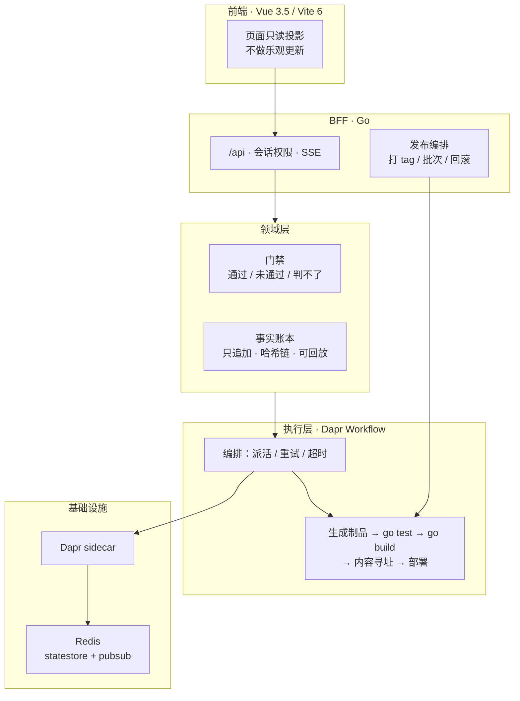
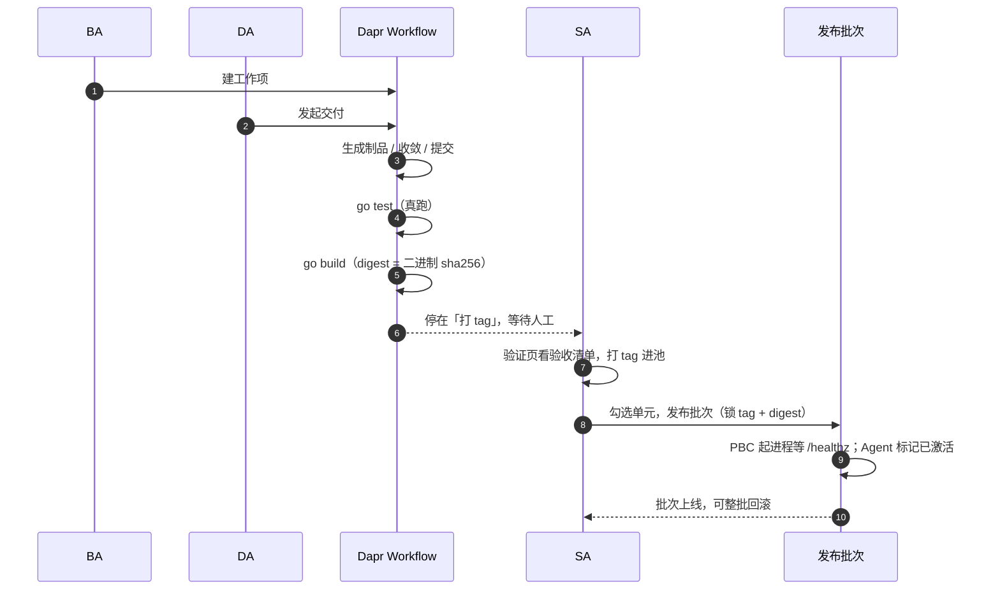
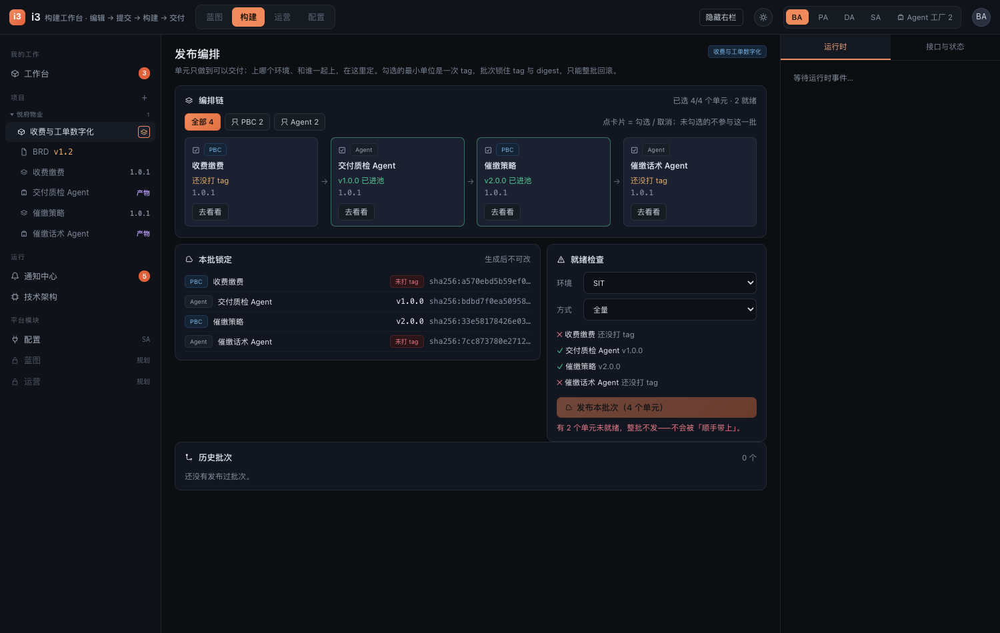
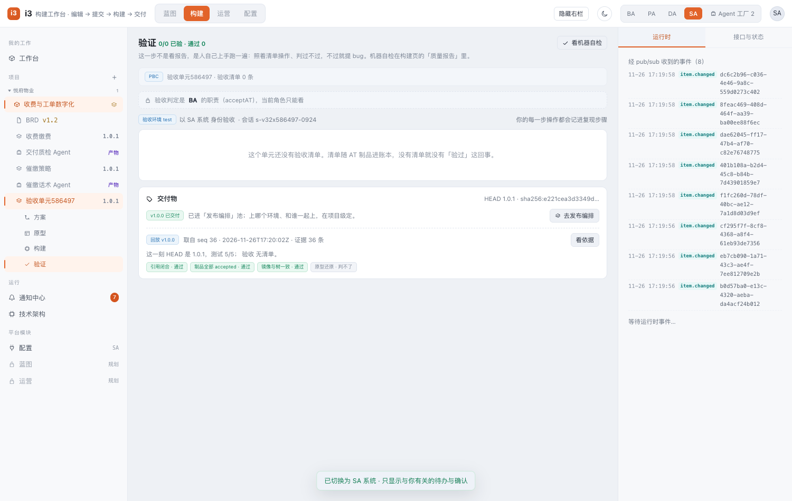
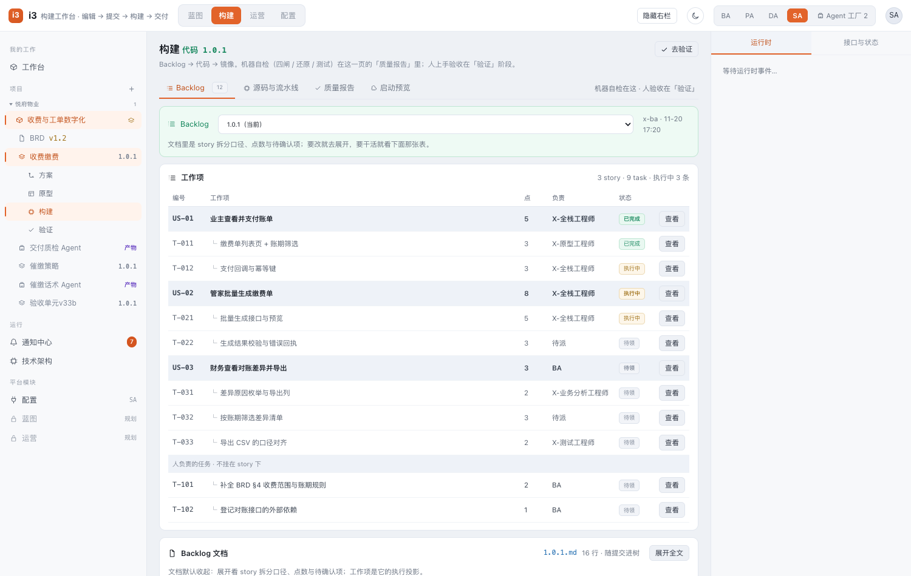

# i3 构建工作台

**让 AI 交付物上得去、回得来、有人签字。**

一份 BRD → 拆成若干交付单元（PBC / Agent）→ 每个单元走完「方案 · 原型 · 构建 · 验证」并打 tag → 项目级发布编排按批次上环境、按批次回滚。整个过程写在一条只追加、可回放的事实账本里。

`Go` · `Dapr` · `Redis` · `Vue 3.5` · `Vite 6` · 五套自动化验收 **200/200**、方案页布局 12/12 · [MIT](./LICENSE)

---

## 目录

- [为什么需要它](#为什么需要它)
- [核心能力](#核心能力)
- [架构](#架构)
- [一条交付是怎么走完的](#一条交付是怎么走完的)
- [快速开始](#快速开始)
- [验收与截图](#验收与截图)
- [项目结构](#项目结构)
- [配置](#配置)
- [文档](#文档)
- [路线图](#路线图)
- [贡献](#贡献)
- [许可](#许可)

---

## 为什么需要它

企业里「能做出一个 AI 应用」已经不是难题，难的是它上线的那一刻：

- **说不清改了什么** —— 服务、Agent、提示词各自升级，线上到底是哪个组合？
- **回不到上一个好版本** —— 只能整段重发，或者干脆回一半。
- **找不到签字的人** —— 谁批的、依据是什么，没有记录。

i3 把这三件事当作产品本身：**交付单元**是基本单位，**tag** 是整体凭据，**批次**是发布与回滚的单位，**事实账本**是唯一权威。

---

## 核心能力

| 能力 | 说明 |
|---|---|
| **两级结构** | 工作空间（只归组）→ 项目（一份 BRD + N 个单元）；项目可新建，也可「加入已有」 |
| **两种交付单元** | PBC（可运行服务）与 Agent（可执行编排 + 评测集）；没有第三种 |
| **四阶段交付** | 方案 → 原型 → 构建 → 验证；机器跑完五步后停在「打 tag」 |
| **打 tag 进池** | 验收清单、测试、门禁任一不过都打不动，并点名还差几条；tag 只认 HEAD |
| **发布编排** | 编排链看就绪/阻塞，勾选最小单位是一次 tag；批次锁 tag 与 digest，生成后不可改 |
| **整批回滚** | 回滚以批次为单位，收掉该批次起的全部进程；不允许只回一半 |
| **真实执行链** | 真 `go test`、真 `go build`、真起进程并等 `/healthz` 200；Agent 产物无进程则 URL 为空 |
| **事实账本** | 哈希链 + etag CAS；投影是纯函数；前端不做乐观更新 |
| **门禁三态** | 通过 / 未通过 / **判不了**——能力未接入时如实标注，不画绿勾 |
| **Backlog 工作台** | 版本下拉、story/task 分层、文档默认收起、人负责任务单独成段 |

---

## 架构



三条不变量：

1. **账本是唯一权威**：状态只能从事实重放；账本被改动会立刻暴露。
2. **判不了就说判不了**：没有证据的门禁输出 `Unknown`，不阻塞发布，也不计为通过。
3. **单元只做到可以交付**：部署属于发布批次，不属于单元。

---

## 一条交付是怎么走完的



任何一步都不是「页面表演」：事实账本里能查到测试条数、digest、部署地址与回滚记录。

---

## 快速开始

前置：Docker（跑 Dapr 组件）、Go 1.27+、Node 22+、宿主机 Redis（默认 6379）。

```bash
# 1) 起 Dapr：placement + scheduler + daprd（sidecar 的 app-port 固定 8080）
docker compose up -d

# 2) 构建并启动
go build -o /tmp/i3-composer-bin ./cmd/i3-composer

ADDR=:8080 \
LEDGER_PREFIX=demo/ \
WORKFLOW_NAME=i3-delivery \
SEED_DEMO=1 \
WORK_DIR=/tmp/i3-work \
ARTIFACT_DIR=/tmp/i3-artifacts \
/tmp/i3-composer-bin
```

打开 <http://127.0.0.1:8080>。

> **两个必须知道的点**
> - 用编译好的二进制启动，不要用 `go run`：`go run` 不向前台子进程转发 SIGTERM，部署起的进程会残留。
> - 应用必须监听 8080：daprd 的 `--app-port` 固定为 8080，换端口时工作流照跑，但 pubsub 事件收不到（启动日志与 `/api/health` 的 `pubsub` 字段会直接说明原因）。

前端单独开发：

```bash
cd web && npm install && npm run dev   # 默认代理到 8080
```

---

## 验收与截图

```bash
go vet ./... && go test ./...
cd web && npm run build

# 行为验收（先用干净账本；v32 必须第一棒）
cd web/e2e
BASE=http://127.0.0.1:8080 RUN_TAG=fin node acceptance_v32.cjs    # 53 项
BASE=http://127.0.0.1:8080 RUN_TAG=fin node acceptance_exec.cjs   # 26 项
BASE=http://127.0.0.1:8080 RUN_TAG=fin node acceptance_flow.cjs   # 35 项
BASE=http://127.0.0.1:8080 RUN_TAG=fin node acceptance_v26.cjs    # 68 项
BASE=http://127.0.0.1:8080 RUN_TAG=fin node acceptance_full.cjs   # 18 项
BASE=http://127.0.0.1:8080 node acceptance_plan.cjs               # 12 项（只读布局，不写账本）
```

合计 **212/212**。断言查的是账本事实，不是页面文案。

「五套」指前五条（各自 `SUMMARY n/n passed` 收尾、都走 `check()`）；`acceptance_plan.cjs` 是同目录的第 6 套，
测方案页布局，按同一套 SUMMARY 口径跑，但既不需要 Dapr 也不写账本。六个脚本各自的开头注释写了
「断言数 / 依赖顺序」，`docs/EXECUTION.md` 第三节有一张同样口径的表——数字以那张表为准，改断言时两处一起改。

### 发布编排：就绪 / 阻塞一眼可见



### 验证页：打 tag 进池



### Backlog：工作项在前，文档收起



---

## 项目结构

```
cmd/i3-composer/          入口：装配账本、workflow、BFF
internal/
├── bff/                  /api、会话权限、SSE、发布编排（projects / release / v23 / v26）
├── store/                事实日志 + 纯函数投影（project / projects / releases / agents）
├── domain/               门禁、版本、种类、评测（纯判断，无 IO）
├── wf/                   Dapr workflow：五步交付、打 tag 前置、发布闸
├── pipeline/             执行侧：生成、测试、构建、部署
├── codegen/ builder/ artifacts/ deployer/   真执行链的四个环节
├── agentexec/            Agent 试跑与对话验收（规则实现，可替换）
└── seed/                 演示起点（actor=seed，可识别）
web/
├── src/                  Vue 3.5：views / components / store.js / api.js
└── e2e/                  Playwright 五套验收 + 方案页布局（acceptance_plan）
specs/                    spec-kit 规格（spec / plan / tasks）
docs/                     白皮书、执行说明、前端接线、自测报告
```

---

## 配置

| 变量 | 默认 | 说明 |
|---|---|---|
| `ADDR` | `:8080` | 监听地址；必须与 sidecar 的 `app-port` 一致 |
| `DAPR_HTTP_ENDPOINT` | `http://127.0.0.1:3500` | sidecar HTTP API |
| `DAPR_GRPC_ENDPOINT` | `127.0.0.1:50001` | workflow work-item 流 |
| `STATE_STORE` | `statestore` | Dapr 状态组件名 |
| `PUBSUB` | `pubsub` | Dapr 发布订阅组件名 |
| `WORKFLOW_COMPONENT` | `dapr` | workflow 组件路径段 |
| `WORKFLOW_NAME` | `i3-delivery` | workflow 名；不同名 = 不同 actor 类型 |
| `LEDGER_PREFIX` | 空 | 账本前缀：同一套 Dapr 上跑隔离账本 |
| `WORK_DIR` | 系统临时目录 | 执行侧工作区 |
| `ARTIFACT_DIR` | `./.i3-artifacts` | 产物仓库（内容寻址） |
| `SEED_DEMO` | `1` | 是否写入演示起点数据 |
| `SESSION_KEY` | 随机 | 会话签名密钥 |

---

## 文档

| 文档 | 内容 |
|---|---|
| [白皮书](docs/whitepaper.md) | 为什么做、怎么建模、架构、边界与路线图 |
| [执行链说明](docs/EXECUTION.md) | 哪些是真的、哪些没接、怎么核对 |
| [前端接线](docs/SPEC-frontend-wiring.md) / [FRONTEND](docs/FRONTEND.md) | 前后端契约与排障 |
| [v3.2 自测报告](docs/selftest-v32/自测报告.md) | 各套断言数、截图、问题清单 |
| [规格](specs/001-v32-core-chain/spec.md) | v3.2 的需求、方案与任务 |

---

## 路线图

- 接入视觉比对：让「原型还原」从判不了变成真判
- 真实模型推理与评测；历史评测不能为新版本背书
- 容器化多环境发布、真实灰度放量
- 多租户与审计导出、交付模板市场

---

## 贡献

- 开发约定见 [AGENTS.md](AGENTS.md)。在 Codex 对话中用 `$speckit-specify` 开始规格，再依次调用 `$speckit-plan`、`$speckit-tasks` 和 `$speckit-implement`。Claude Code 使用对应的 `/speckit-…` 命令。
- 提交前跑通：`go vet` / `go test` / `npm run build` / 五套 e2e（外加 `acceptance_plan.cjs`）；
- 改门禁、部署或账本语义时，同一轮更新自测报告与截图；
- 提交信息用中文，说明「改了什么、为什么」。

---

## 许可

[MIT](./LICENSE) © 2026 张昆 (NukZhang)

可以自由使用、修改、分发，包括闭源商用，只需保留版权声明与许可声明。
