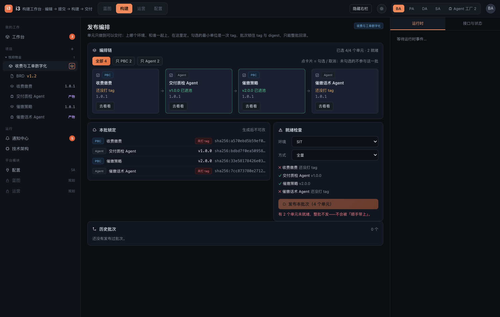

# 4.3 四阶段交付 → 打 tag 进池 → 项目级发布编排（v3.2）

# **报告概况**

| 项 | 内容 |
|---|---|
| 报告对象 | i3 构建工作台 v3.2 核心交付链路：单元四阶段 → 人打 tag 进「发布编排」池 → 项目级批次发布 / 整批回滚 |
| 需求来源 | `i3-composer_交互原型_v3.2.html` 与 `原型说明_v2.8–v3.2.md`（`/Users/nukzhang/Documents/企业AI落地/`） |
| 周期 | 2026-11-25 至 2026-11-26 |
| 截至 | 2026-11-26 14:33（`v34b/` 干净账本上五套验收 153/153 通过之后） |
| 执行人 | Claude Code（Playwright 自动化 + 直接核对账本事实） |
| 被测环境 | `http://127.0.0.1:8080`：Go BFF + Vue 3.5 / Vite 6；Dapr sidecar（statestore / pubsub = Redis），workflow 名 `i3-delivery-v34b`，账本前缀 `v34b/` |
| 测试账号 | BA / DA / SA / PA（会话角色，权限只在服务端判定） |
| 判定口径 | 全部期望项一致＝通过；任一项不一致＝不通过；环境、数据或权限不足导致无法执行＝阻塞；未覆盖＝未执行 |
| 样例数据替换 | 种子数据（5 名平台员工 + 2 个交付 Agent + 4 个单元），actor 为 `seed`；视觉比对、真实模型未接入 |

# **总体状态**

v3.2 的核心语义已经落地，并且每一步都能回账本核对：

- **单元只剩四个阶段**（方案 / 原型 / 构建 / 验证）：机器跑完五步（生成制品 / 收敛 / 提交 / 测试 / 构建）后停在「打 tag」，**单元自己不再部署**；
- **打 tag 是人的动作**：验证页末尾「打 tag 固化交付物」，验收清单没全过、测试不全过、闸门不过都打不动，且会点名还差几条；tag 只认 HEAD；
- **组合单元取消**：后端只接受 pbc / agent 两种构成，hybrid 被明确拒绝并说明「一个单元只有一个 tag，要一起上就进同一批次」；
- **发布升到项目级**：编排链上看得见就绪/阻塞；勾选的最小单位是一次 tag；批次锁住 tag 与 digest，没打 tag 的单元进不来也不会被顺手带上；PBC 真起进程并等 `/healthz` 200，Agent 产物无进程、URL 如实为空；**回滚只能整批，进程真的被收掉**；
- **Agent 工厂拆成两层**：平台员工 5 名（生产者，不单独打 tag）与交付的 Agent 2 个（产物，走四阶段、有评测）；命名统一「XX 工程师」；
- **Backlog（v3.2 本次改动）**：版本改下拉并标「（当前）」、工作项提到最前、story/task 分层（`└`）、文档默认收起；顺带修掉 task 挂不到 story 与负责人串台两个真问题。

五套自动化验收共 **153 项**全部通过；`go vet` / `go test ./...` / `npm run build` 全绿。

| 通过 | 不通过 | 阻塞 | 未执行 |
|---|---|---|---|
| 153 | 0 | 0 | 0 |

本轮增量（修 #11）：「工具白名单」闸不再只看「名单非空」。编排里用到名单外的工具时
这条闸变红并点名「工具 X 在 节点 Y(id)」；执行器在工具节点上按同一份名单拦截（越界不调用、
记 `tool.blocked`）；对话验收遇到被拒节点直接 400 且一条对话事实都不落；试跑页显示
「跑完 · 被拒 N 步」，被拒节点在耗时链上单独标红。`acceptance_v26` 由 34 项增至 45 项。

本轮增量（修 #12）：打 tag 时先把「当时算出的四闸 + 验收/测试摘要 + 谁按的」落成一条
`gate.evaluated` 事实，再落 `tag.created`——证据先于凭据，中途崩了也不会出现「有 tag、
没依据」。新增只读出口 `GET /api/units/{id}/replay?tag=vX`，用 `store.UpTo` /
`store.ProjectAsOf` 把投影窗口截到 `tag.created` 那一刻，回答「这个 tag 凭什么能发」，
而不是按今天的账本重算（宪法 I）。验证页交付物卡下方显示回放区：tag、取自 seq、证据条数、
当时的 HEAD / 测试 / 验收摘要、四闸（「判不了」不画绿）；可展开逐条看那批事实。
老账本里没有 `gate.evaluated` 的 tag 如实返回 `gatesNote`「当时没记录闸门」，不补今天的闸
冒充当时（宪法 II）。`acceptance_v32` 由 37 项增至 46 项。

说明：「原型还原」仍按能力边界标为「判不了」，不画绿勾；它不挡打 tag，但也不计入通过。

# **用例执行明细**

## 一、结构：四阶段与项目级入口

| 编号 | 场景 | 验收期望（原型 v3.2） | 实际结果 | 结论 |
|---|---|---|---|---|
| TC-01 | 侧栏与单元阶段 | 单元只剩 方案/原型/构建/验证；发布编排入口在项目行，不占一行 | 侧栏四阶段、无「发布」；项目行右侧有编排图标（灰/黄/绿＝无单元/待交付/全就绪）（截图 01） | 通过 |
| TC-02 | 发布编排页 | 编排链列出项目下单元，显示就绪与阻塞原因；筛选与勾选联动 | 4 个单元（fee:pbc / qa:agent / dun:pbc / dunx:agent），2 就绪 2 阻塞；「只 Agent」筛选后选中 2 个；卡片可勾选（截图 02） | 通过 |
| TC-03 | 勾选与就绪检查 | 未打 tag 的单元不能进批次；未勾选的保持线上现状 | 每张卡显示 tag 或「还没打 tag」；未勾选卡片虚线并注明不参与本批；有阻塞时「发布本批次」禁用并点名 | 通过 |

## 二、交付：四阶段与打 tag

| 编号 | 场景 | 验收期望（原型 v3.2） | 实际结果 | 结论 |
|---|---|---|---|---|
| TC-04 | 新单元交付 | 机器五步跑完停在「打 tag」；账本里有 test.run / build.succeeded，**没有** deploy.succeeded | 新建 `v32xv34b`：`run=verified, step=5`；事实序列含 `test.run`、`build.succeeded`、`item.verified`，无部署事实（截图 04） | 通过 |
| TC-05 | 测试与 digest 是真的 | 测试条数来自真跑；digest 是内容 sha256 | `test.run` 5/5（x-qa）；digest `sha256:7a4a69fb…849f` | 通过 |
| TC-06 | 打 tag 的前置 | 验收没全过 / 评测不达标 / 闸门不过，都不能打 tag，并点名 | fee：`还差 5 条验收未通过（1/6）`；dunx：`还差 1 条验收未通过（4/5）`（评测 35/38 也不达标） | 通过 |
| TC-07 | 打 tag 进池 | SA 打 tag 后 HEAD 上有 tag、单元就绪；重复打 tag 被拒 | `tag.created`（v1.0.0，带 commit/digest）；重复打返回 400「HEAD 已打过」；编排里 `ready=true`（截图 05） | 通过 |
| TC-08 | hybrid 取消 | 只接受 pbc / agent；组合不是单元的属性 | 建 hybrid 被 400 拒绝，错误信息说明「一个单元只有一个 tag，要一起上就进同一批次」 | 通过 |

## 三、发布编排：批次与回滚

| 编号 | 场景 | 验收期望（原型 v2.8/v2.9/v3.0） | 实际结果 | 结论 |
|---|---|---|---|---|
| TC-09 | 混合批次 | 一次批次可同时锁一个 PBC 与一个 Agent 的 tag | `REL-20261126-01`（SIT / 全量）锁定 `qa v1.0.0` + `dun v2.0.0`（截图 03） | 通过 |
| TC-10 | 真部署 vs 如实跳过 | PBC 起进程并健康检查；Agent 产物没有进程就没有 URL | dun 部署 `http://127.0.0.1:64528`，`/healthz` 200；qa `status=activated`、`url` 为空 | 通过 |
| TC-11 | 整批回滚 | 只能整批回；回滚后进程停；重复回滚被拒 | 批次转 `rolledback`（时间/人可查）；进程 `/healthz` 不再 200；第二次回滚 400 | 通过 |
| TC-12 | 未打 tag 拦截 | 没 tag 的单元不会进批次，也不会被顺手带上 | 选 fee 发布：400「收费缴费 还没打 tag，不能进批次」 | 通过 |

## 四、Backlog（v3.2 本次改动）

| 编号 | 场景 | 验收期望 | 实际结果 | 结论 |
|---|---|---|---|---|
| TC-13 | 版本下拉 | 版本改下拉，当前版标「（当前）」，选历史显示「历史版本」 | 构建页 Backlog 有下拉，选项 `1.0.1（当前）`；页面给出「文档里是 story 拆分口径…」说明（截图 06） | 通过 |
| TC-14 | 工作项前置与分层 | 工作项在文档之前；story 加粗、task 用 `└` 挂；人负责的任务单独一段 | 3 story + 7 个挂载 task + 2 条「人负责的任务」；工作项表在文档卡之前 | 通过 |
| TC-15 | 文档默认收起 | 只留字数与「展开全文」 | 显示「16 行 · 随提交进树 / 展开全文」，默认不渲染正文 | 通过 |
| TC-16 | 修掉的两个真问题 | task 不能丢；负责人不能串成默认值 | task 正常挂到 story 下；负责人显示 X-原型工程师 / X-全栈工程师 / X-业务分析工程师（不再全是全栈） | 通过 |

## 五、Agent 工厂与命名

| 编号 | 场景 | 验收期望（v3.1） | 实际结果 | 结论 |
|---|---|---|---|---|
| TC-17 | 员工与产物分离 | 平台员工 5 名只读；交付的 Agent 2 个可点开 | 页面分上下两块；员工 5 名、产物 2 个（质检 Agent / 催缴话术 Agent）；产物带「产物」徽章与所属单元（截图 07） | 通过 |
| TC-18 | 命名统一 | 不出现「质检工程师 / 催缴专员 / UI设计师 / 业务分析员」 | 全站扫描无这些字样；员工名均为「XX 工程师」 | 通过 |

## 六、回归与工程闸

| 编号 | 场景 | 验收期望 | 实际结果 | 结论 |
|---|---|---|---|---|
| TC-19 | 执行侧证据（`acceptance_exec`） | 真测试 / 真构建 / 批次部署 / 回滚收进程 / pubsub 收发 | 25/25 通过 | 通过 |
| TC-20 | 写路径与权限（`acceptance_flow`） | 发起 403、运行中重复发起 400、DA 打 tag 403、SA 打 tag 成功、通知由事实派生 | 19/19 通过 | 通过 |
| TC-21 | 从零全流程（`acceptance_full`） | 建单元 → 任务 → 五步 → tag → 批次 → 健康检查 | 18/18 通过 | 通过 |
| TC-22 | 工具体验回归（`acceptance_v26`） | 编排工作台、digest 闸、工具白名单闸（越界即红、试跑留痕、对话拒绝）、试跑与沉淀、验收台、四单元两构成 | 45/45 通过 | 通过 |
| TC-23 | 工程闸 | `go vet` 0、`go test` 全 ok、`npm run build` 成功 | 全绿（`logs/go-gates.log`、`logs/npm-build.log`） | 通过 |
| TC-24 | 按 tag 回放（`acceptance_v32` 第 11 节） | 打 tag 定格当时的闸；回放只读当时窗口、不含 tag 之后的事实；老账本没有闸事实就如实说「没记录」 | 打 tag 后账本紧邻两条 `gate.evaluated → tag.created`（`/api/facts` 倒序看）；`/replay` 回 4 闸（含一条 unknown）、commit 停在打 tag 那次，而 `/api/state` 已前进到新提交；未知 tag 400 点名并列出可选项、不存在的单元 404；`dun v2.0.0` 老 tag 返回 `gates:null` + `gatesNote`；验证页回放区可展开逐条看证据（截图 08） | 通过 |

小计：`acceptance_v32` 46/46、`acceptance_exec` 25/25、`acceptance_flow` 19/19、`acceptance_full` 18/18、`acceptance_v26` 45/45，合计 **153/153**。

# **附：复现截图**

截图目录：`docs/selftest-v32/shots/`（`v34b/` 干净账本上的重跑，`acceptance_v32` 46/46 通过；截图统一为明主题，`summary.json` 同轮生成）。

#### 结构与发布编排


/Users/nukzhang/projects/i3-composer/docs/selftest-v32/shots/01-侧栏四阶段.png


/Users/nukzhang/projects/i3-composer/docs/selftest-v32/shots/02-发布编排.png


/Users/nukzhang/projects/i3-composer/docs/selftest-v32/shots/03-批次发布后.png

#### 打 tag


/Users/nukzhang/projects/i3-composer/docs/selftest-v32/shots/04-打tag前.png


/Users/nukzhang/projects/i3-composer/docs/selftest-v32/shots/05-打tag后.png

#### Backlog 与 Agent 工厂


/Users/nukzhang/projects/i3-composer/docs/selftest-v32/shots/06-Backlog.png


/Users/nukzhang/projects/i3-composer/docs/selftest-v32/shots/07-Agent工厂.png

#### 回放


/Users/nukzhang/projects/i3-composer/docs/selftest-v32/shots/08-回放.png

# **附：截图对照**

| 用例编号 | 截图文件 | 本地文件路径 |
|---|---|---|
| TC-01 | 01-侧栏四阶段.png | /Users/nukzhang/projects/i3-composer/docs/selftest-v32/shots/01-侧栏四阶段.png |
| TC-02、TC-03 | 02-发布编排.png | /Users/nukzhang/projects/i3-composer/docs/selftest-v32/shots/02-发布编排.png |
| TC-09、TC-10 | 03-批次发布后.png | /Users/nukzhang/projects/i3-composer/docs/selftest-v32/shots/03-批次发布后.png |
| TC-04 | 04-打tag前.png | /Users/nukzhang/projects/i3-composer/docs/selftest-v32/shots/04-打tag前.png |
| TC-07 | 05-打tag后.png | /Users/nukzhang/projects/i3-composer/docs/selftest-v32/shots/05-打tag后.png |
| TC-13~TC-16 | 06-Backlog.png | /Users/nukzhang/projects/i3-composer/docs/selftest-v32/shots/06-Backlog.png |
| TC-17 | 07-Agent工厂.png | /Users/nukzhang/projects/i3-composer/docs/selftest-v32/shots/07-Agent工厂.png |
| TC-24 | 08-回放.png | /Users/nukzhang/projects/i3-composer/docs/selftest-v32/shots/08-回放.png |

# **附：问题清单（建议修复项）**

| 编号 | 级别 | 问题 | 涉及位置 | 修复建议 |
|---|---|---|---|---|
| P-01 | 待确认 | 「原型还原」闸仍判不了：视觉比对未接入 | `internal/domain/gates.go` | 接入截图 diff 服务后写「未处理差异」事实 |
| P-02 | 待确认 | Agent 评测（61/64、35/38）跑内置评测集，模型节点是规则实现 | `internal/agentexec` | 接真实模型后重跑并在事实里记模型版本 |
| P-03 | 待确认 | 发布「环境」只是标签：SIT/UAT/预发/生产都用本地进程 + 随机端口，没有真正的多环境资源 | `internal/bff/release.go`、`internal/pipeline` | 接容器/编排层；资源表与监控随之联动 |
| P-04 | 待确认 | 灰度（10-50-100）只记录在批次上，没有真的分批放量 | 同上 | 按单元分批推进 + 达标检查 |
| P-05 | P2 | Backlog 历史版本只保文档：种子只有一版，切换后隐藏工作项的逻辑已实现但缺少第二版可演示 | `internal/seed` | 种子里补一版历史 Backlog 文档 |
| P-06 | P2 | 「把组合单元拆成两个」只有文案说明，没有拆分动作 | `web/src/views/ProjectsView.vue` | 提供拆分入口（原单元归档 + 两个新单元） |
| P-07 | P2 | 批次不记录「未勾选单元的当前线上版本」，看不出一次发布后整体是什么版本 | `internal/store/releases.go` | 批次里附上未参与单元的当前 tag 快照 |

# **附：复跑命令**

```bash
docker compose up -d
go build -o /tmp/i3-composer-bin ./cmd/i3-composer
ADDR=:8080 LEDGER_PREFIX=v34b/ WORKFLOW_NAME=i3-delivery-v34b SEED_DEMO=1 \
  WORK_DIR=/tmp/i3-v34b-work ARTIFACT_DIR=/tmp/i3-v34b-artifacts /tmp/i3-composer-bin

# v32 必须第一棒（它断言项目下只有 4 个种子单元）
cd web/e2e
for s in acceptance_v32 acceptance_exec acceptance_flow acceptance_full acceptance_v26; do
  BASE=http://127.0.0.1:8080 RUN_TAG=v34b node $s.cjs
done

go vet ./... && go test ./...
cd web && npm run build
```
