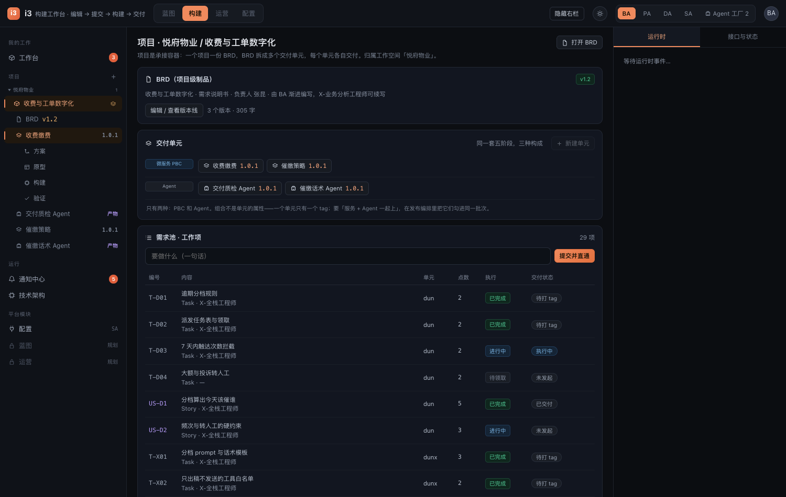
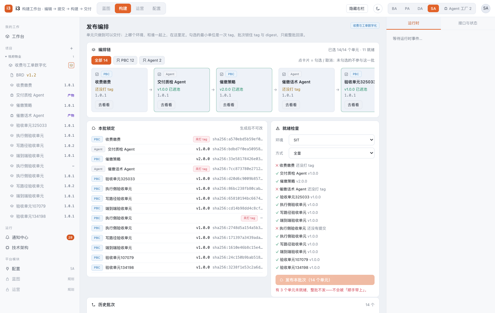
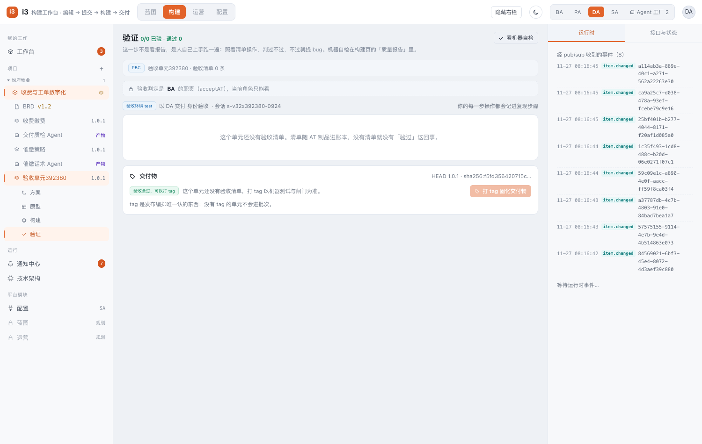
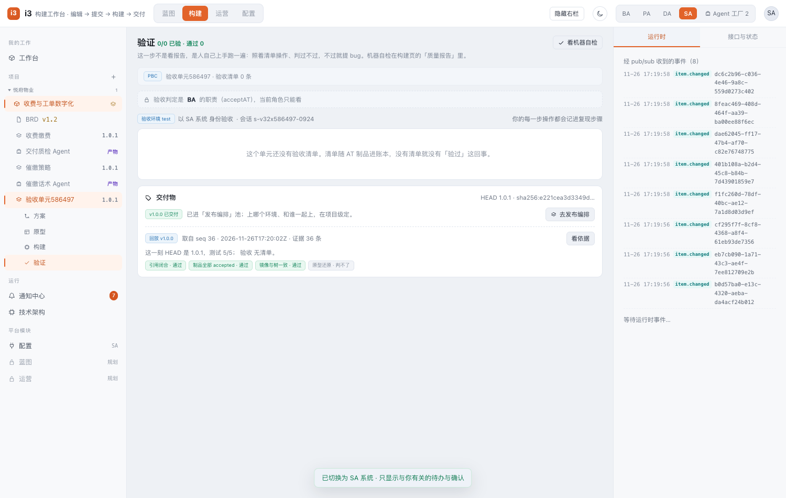
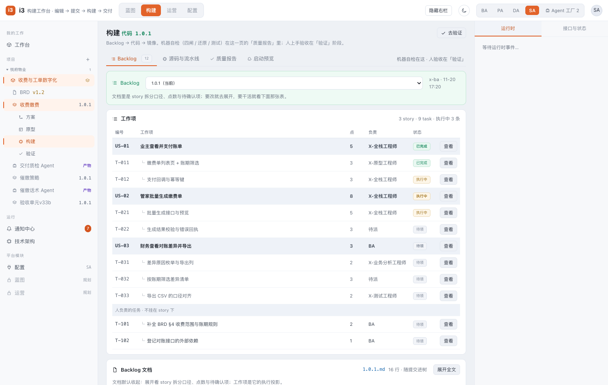
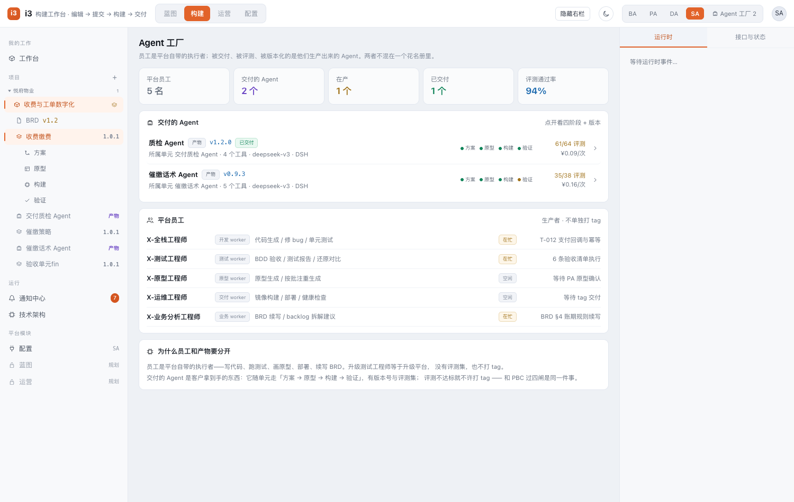
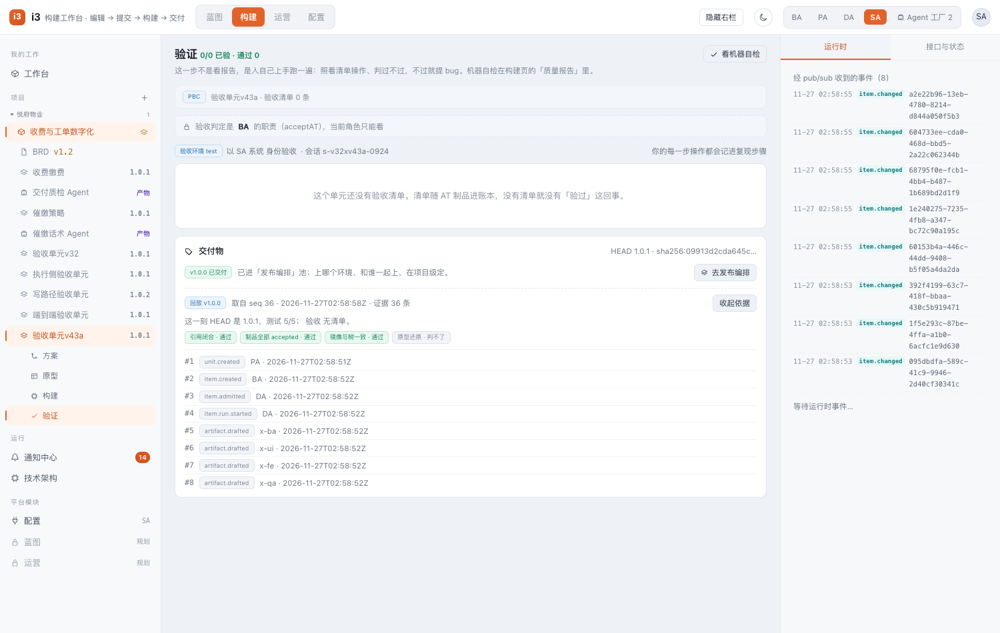

# 4.3 四阶段交付 → 打 tag 进池 → 项目级发布编排（v3.2）

## 可复核的基线复跑

| 项 | 本轮记录 |
|---|---|
| 被测提交 | [`5a88e9fcecb6f8273dbb290ac62b4d7d855ad145`](https://github.com/NukZhang/i3-composer/commit/5a88e9fcecb6f8273dbb290ac62b4d7d855ad145) |
| 工作树状态 | 构建前 `git status --porcelain` 为空。应用、前端和验收脚本均来自该提交的同一份 `git archive`，脚本挂载为只读。 |
| 复跑时间 | 2026-11-27 19:13:51–19:15:48（UTC+08:00） |
| 账本和环境 | 独立 Compose 项目 `i3-issue-27-evidence`，新 Redis 卷与账本前缀 `issue27-evidence/`，workflow `i3-delivery`，Dapr 1.19.0。`/api/health` 确认 `pubsub.checked=true`、`pubsub.ok=true`。 |

| 执行顺序 | 结果 |
|---|---:|
| `acceptance_v32.cjs` | 51/51 |
| `acceptance_exec.cjs` | 28/28 |
| `acceptance_flow.cjs` | 33/33 |
| `acceptance_full.cjs` | 20/20 |
| `acceptance_v26.cjs` | 66/66 |
| **合计** | **198/198** |

`go vet ./...`、`go test -count=1 ./...`、`npm --prefix web ci`、`npm --prefix web run build` 和 Pub/Sub 前置检查测试通过。
复跑依照[执行说明](../EXECUTION.md#三怎么自己验一遍)和[隔离容器复跑命令](隔离容器复跑.md)，并使用以下本机配置；这些环境适配不改被测提交：

- 归档基线提交后，用工作区 `../docker-local/Dockerfile` 的 `app` target 构建归档目录。使用工作区 `compose.yml` 和 `regression.yml`，指定独立项目 `i3-issue-27-evidence`、宿主端口 19427、子网 `10.245.150.16/28`。应用监听 `127.0.0.1:8080`，设置 `WEB_DIR=/app/web/dist`、`REQUIRE_PUBSUB=1`，声明式订阅挂载归档中的 `components/subscription.yaml`。
- 为解除 Dapr 和应用启动探针互等，以同网络命名空间的临时 HTTP 转发器监听 `127.0.0.2:8080`，转发到真实应用 `127.0.0.1:8080`；应用未就绪时 `/dapr/config` 返回 404，其他请求返回 503。让 daprd 在转发器可连后启动，配置 `--app-channel-address=127.0.0.2 --app-port=8080`，保留真实 Dapr 声明式订阅。
- 浏览器容器与应用共享网络，`BASE=http://127.0.0.1:8080`。将源码归档只读挂载到 `/source`，在 `/source/web/e2e` 下运行脚本；`NODE_PATH=/tmp/regression/node_modules`。把脚本中的 `CHROME` 路径软链接到容器的 `/usr/bin/chromium`，`SHOTS` 指向单独挂载的输出目录，不写入仓库或覆盖历史截图。

[本轮日志摘录](logs/5a88e9f-summary.log)与上表仅证明这个被测提交和这轮配置。曾在含未提交改动工作树上得到的 133/133（[#27](https://github.com/NukZhang/i3-composer/issues/27)）不代表任何提交；下文历史结果和截图不与本轮混用。

## 2026-11-27 · 从 Docker 宿主机核对 PBC 发布批次（#38）

19:50:26–19:52:07（UTC+08:00）在独立 Compose 项目 `i3-issue-38-runtime` 使用全新 Redis 卷，验证通过真实 Dapr 1.19、Chromium 和工作台宿主映射端口 `20039` 完成。五套 Playwright 按顺序通过 **201/201**（v32 54/54、exec 28/28、flow 33/33、full 20/20、v26 66/66）。`go vet ./...`、`go test -count=1 ./...`、`npm --prefix web ci` 和 `npm --prefix web run build` 均通过。

| 验收项 | 观察结果 |
|---|---|
| 发布页提示 | v32 发布 SIT 后，页面标明进程内部地址，提供「核对 PBC 运行」同源入口。 [发布页截图](shots/issue38-release-entry.png) |
| 核对实际运行的批次 | 五套回归结束后，从宿主机连续发布两次 SIT。点击入口对应的 HTTP 路径均返回 200，单元为 `dun`，提交号为 `1.0.1`，tag 为 `v2.0.0`，digest 与批次锁定值一致。 |
| 重发与回滚 | 重发后旧批次入口返回 404。回滚旧批次后，新批次入口仍返回原来的证明。回滚新批次后，同一入口返回 404。 |
| 落链顺序与项目隔离 | 真实进程回归测试以相反顺序写入两个批次，核对和回滚仍命中对应实例。账本重放测试确认新的回滚事实只作用于指定项目的批次，旧格式继续按历史规则重放。 |

[宿主访问与账本序号摘录](logs/issue38-host.log)

## 2026-11-27 · 交付单元作废与复登（#40）

20:48:20–20:50:33（UTC+08:00）在独立 Compose 项目 `i3-issue-40-release` 的新 Redis 卷中验证，Dapr Pub/Sub 检查正常。五套 Playwright 按顺序通过 **210/210**（v32 59/59、exec 28/28、flow 33/33、full 20/20、v26 70/70）。

| 验收项 | 观察结果 |
|---|---|
| 权限与作废 | DA 请求返回 403，注册表序号不变。PA 请求返回 200，注册表追加序号 10 的 `unit.removed`，侧栏移除单元，详情返回 404。 [作废后截图](shots/issue40-removed.png) |
| 同 ID 复登 | 复登返回 201，侧栏和详情显示新名称。单元账本仍能读取原有登记事实；针对旧登记的 DELETE 返回 409。 [复登后截图](shots/issue40-reregistered.png) |
| 历史兼容 | 单测比较作废前后的事实哈希，核对原工作项编号没有被其他单元复用。另在五套回归结束后作废种子 `fee`，再追加 65 条登记事实并用同一 Redis 卷重启，通过列表和详情确认 `fee` 保持作废。 |

[接口与账本序号摘录](logs/issue40-unit-removal.log)

# **历史报告概况**

| 项 | 内容 |
|---|---|
| 报告对象 | i3 构建工作台 v3.2 核心交付链路：单元四阶段 → 人打 tag 进「发布编排」池 → 项目级批次发布 / 整批回滚 |
| 需求来源 | `i3-composer_交互原型_v3.2.html` 与 `原型说明_v2.8–v3.2.md`（`/Users/nukzhang/Documents/企业AI落地/`） |
| 周期 | 2026-11-25 至 2026-11-26 |
| 截至 | 2026-11-27 06:00（历史运行：隔离 sidecar、干净账本 `v55/`，报告记录 182/182） |
| Commit SHA | 历史运行未记录，无法对应到具体提交 |
| 工作树状态 | 历史运行未记录 `git status --porcelain`，不能用作某个提交的通过证据 |
| 执行人 | Claude Code（Playwright 自动化 + 直接核对账本事实） |
| 被测环境 | `http://127.0.0.1:8081`：Go BFF + Vue 3.5 / Vite 6；Dapr sidecar（statestore / pubsub = Redis），workflow 名 `i3-delivery-55`，账本前缀 `v55/`。用独立 app-id 的 sidecar，是因为 workflow 名与 app-id 绑定：换前缀不换 app-id 时，新 workflow 名不会被注册（见「已知问题」） |
| 测试账号 | BA / DA / SA / PA（会话角色，权限只在服务端判定） |
| 判定口径 | 全部期望项一致＝通过；任一项不一致＝不通过；环境、数据或权限不足导致无法执行＝阻塞；未覆盖＝未执行 |
| 样例数据替换 | 种子数据（5 名平台员工 + 2 个交付 Agent + 4 个单元），actor 为 `seed`；视觉比对、真实模型未接入 |

# **历史运行总体状态**

v3.2 的核心语义已经落地，并且每一步都能回账本核对：

- **单元只剩四个阶段**（方案 / 原型 / 构建 / 验证）：机器跑完五步（生成制品 / 收敛 / 提交 / 测试 / 构建）后停在「打 tag」，**单元自己不再部署**；
- **打 tag 是人的动作**：验证页末尾「打 tag 固化交付物」，验收清单没全过、测试不全过、闸门不过都打不动，且会点名还差几条；tag 只认 HEAD；
- **组合单元取消**：后端只接受 pbc / agent 两种构成，hybrid 被明确拒绝并说明「一个单元只有一个 tag，要一起上就进同一批次」；
- **发布升到项目级**：编排链上看得见就绪/阻塞；勾选的最小单位是一次 tag；批次锁住 tag 与 digest，没打 tag 的单元进不来也不会被顺手带上；PBC 真起进程并等 `/healthz` 200，Agent 产物无进程、URL 如实为空；**回滚只能整批，进程真的被收掉**；
- **Agent 工厂拆成两层**：平台员工 5 名（生产者，不单独打 tag）与交付的 Agent 2 个（产物，走四阶段、有评测）；命名统一「XX 工程师」；
- **Backlog（v3.2 本次改动）**：版本改下拉并标「（当前）」、工作项提到最前、story/task 分层（`└`）、文档默认收起；顺带修掉 task 挂不到 story 与负责人串台两个真问题。

下表保留 `v55/` 历史运行的原始汇总，不作为当前提交的验收结论。

| 通过 | 不通过 | 阻塞 | 未执行 |
|---|---|---|---|
| 182 | 0 | 0 | 0 |

本轮增量（修 #60）：启动自检不再只看「进程起来了」。以前 `WORKFLOW_NAME` 与 sidecar 的 app-id
对不上时，进程照常监听、每次发起都只落一句 `is not registered`，验收整轮全挂却看不出原因。
现在 `cmd/i3-composer` 在写种子、开监听之前先放一个只回一句话的探针 workflow（`i3-probe`）
走一遍 gRPC：名字没被认领就**拒绝启动**，报错带 workflow 名、sidecar app-id（`/v1.0/metadata`
的顶层 `id`）与两条改法。实测：

- `WORKFLOW_NAME=i3-delivery-nope` 对 v56 sidecar：`listen` 从未打开、进程 exit 非 0；
- 正常 `i3-delivery`：自检通过后监听，`acceptance_exec` 26/26、`acceptance_flow` 29/29 全过，
  `acceptance_v26` 62/65（3 项是 #61 的多实例试跑竞争，与本改动无关）；
- 顺带修掉「监听失败（端口被占）也返回退出码 0」：现在按启动失败返回错误。

## 2026-11-27 · 通用工作项的制品与验收证据（#79）

在独立 Compose 项目 `i3-issue-79-verified` 和干净演示账本执行。访客通行凭证工作项 US-12 的 PRD、AT、Backlog 与代码说明保留了「过期后失效」口径。生成的 AT 将访客条件拆成验收草案，制品标注模板占位，代码没有缴费逻辑。

提交 `1.0.1` 的 `test.run` 在 seq 30 记录脚手架检查 1/1，`build.succeeded` 在 seq 32 记录相同提交的构建摘要。质量报告和验证页显示业务未验证，SA 对没有人工清单的提交打 tag 收到 HTTP 400。 [质量报告](shots/issue-79-quality-scope.png) · [验证页](shots/issue-79-verify-scope.png)

工程验证通过。五套 Playwright 共 **233/233**，依次为 v32 70、exec 35、flow 33、full 20、v26 75。访客专项 4/4，材料入库业务专项 5/5。 [同轮事实与回归摘录](logs/issue-79-codegen-scope.txt)

## 2026-11-27 · 缺陷修复与重验（#77）

专项 `issue77case` 在独立 Compose 与干净账本运行。新单元验收失败、缺陷和修复项分别落在 seq 35、36、37。修复项 US-05 继承了 AT-02 的 Given、When、Then，以及原工作项 US-04 的数据范围和责任人。DA 直接发起后，提交 `1.0.2` 机器测试 5/5，AT-02 显示待重验。SA 提前打 tag 返回 400，BA 逐条验收后打成 `v1.0.0`。[待重验截图](shots/issue-77-retest.png)

旧单元 dun 的修复项 US-06 要求 BA 补数据范围和责任人，原验收口径已预填。依次修复 DR-4 和 DR-5 后，清单分别绑定提交 `1.0.2` 与 `1.0.3`。另一次机器测试故意失败，seq 74 写入 `item.blocked`，验收表未标记待重验。[准入补录截图](shots/issue-77-repair-inputs.png) · [事实与回归摘录](logs/issue-77-defect-retest.txt)

工程验证通过。同一版产品在独立账本运行五套 Playwright，共 **233/233**，依次为 v32 70、exec 35、flow 33、full 20、v26 75。缺陷修复专项 6/6。

## 2026-11-27 · 工作项交付入口（#75）

在独立 Compose 项目及干净演示账本运行 `issue75verified`。机器完成五步后写入 `item.verified`。工作项可打开当前单元的验收清单，方案页指向验证页打 tag，工作台与侧栏使用同一待办计数。同轮核对截图中的 US-13，`test.run`、`build.succeeded` 和 `item.verified` 分别在 seq 29、31、33，工作项执行阶段没有部署事实。[工作项截图](shots/issue-75-work-item.png)

真实 Dapr 专项验证中，向旧 `/answer` 路由发请求返回 HTTP 404，工作项账本仍在 seq 33。BA 验收后，SA 打 tag 并发布 SIT，批次锁定该 tag，部署进程的 `/healthz` 返回 HTTP 200。工程验证通过，五套 Playwright 共 **233/233**，依次为 v32 70、exec 35、flow 33、full 20、v26 75。[事实与回归摘录](logs/issue-75-item-delivery.txt)

## 2026-11-27 · 活动草稿阻断打 tag（#71）

在独立 Compose 项目和干净演示账本上使用 `RUN_TAG=issue71verified`。第一次交付后，BA 验收通过提交 `1.0.1`，DA 保存代码草稿 `1.0.7`。账本新增 `artifact.drafted`（seq 38），质量闸点名草稿，SA 打 tag 返回 HTTP 400，账本没有新增门禁或 tag 事实。

重新发起交付后，提交 `1.0.2` 包含手工修改的代码和新增机器用例。机器测试 6/6，构建产生 SHA-256 摘要。BA 验收通过后，`gate.evaluated`（seq 68）与 `tag.created`（seq 69）相邻落账，固化为 `v1.0.0`。再保存代码草稿 `1.0.12` 时，质量报告标红当前闸，回放仍显示 `1.0.2` 打 tag 时的验收证据。[质量报告截图](shots/issue-71-draft-gates.png) · [事实与回归摘录](logs/issue-71-draft-gates.txt)

工程验证通过。五套 Playwright 共 **229/229**，依次为 v32 70、exec 31、flow 33、full 20、v26 75。材料入库专项 5/5。

## 2026-11-27 · 材料入库 PBC 交付门禁（#34、#35）

在独立 Docker 环境从界面新建项目与 PBC，依次保存 BRD、PRD、AD、AT，并发起两次交付。

| 验收项 | 结果与证据 |
|---|---|
| 人工正文保留 | HEAD `1.0.2` 引用的 PRD、AD、AT 与编辑器保存正文逐字一致，来源保留为 `手动编辑`，三个版本均为 `accepted`。 |
| 零条验收拦截 | HEAD `1.0.1` 构建后，SA 验证页禁用打 tag，提示缺少人工验收清单。自动化接口复测返回 HTTP 400。 [截图](shots/pbc-zero-acceptance.jpg) |
| 当前提交逐条判定 | 补齐 AT 后，HEAD `1.0.2` 显示 5 条待判定，SA 仍无法打 tag。后端回归覆盖旧版本判定、当前待判定或失败及全通过。 |
| 通过后交付 | 同项目技术验收单元确认当前提交机器测试 `5/5` 和 SHA-256 摘要，BA 判定 `1/1` 通过，SA 打 `v1.0.0` 并发布到 SIT。部署最终镜像后复发批次 `REL-20261127-02`，容器内 `/healthz` 返回 HTTP 200。 [截图](shots/pbc-accepted-tag.jpg) |

账本证据见 [材料入库与技术交付摘录](logs/pbc-acceptance-34-35.json)。五套 Playwright 在干净账本共 **181/181**，分项为 v32 51、exec 27、flow 33、full 20、v26 50。另运行 `go vet ./...`、`go test -count=1 ./...` 和 Vite 构建。

材料入库业务单元的五条 AT 保持待验收。构建产物尚无入库业务接口，业务实现由 #37 跟踪。

本轮增量（修 #11）：「工具白名单」闸不再只看「名单非空」。编排里用到名单外的工具时
这条闸变红并点名「工具 X 在 节点 Y(id)」；执行器在工具节点上按同一份名单拦截（越界不调用、
记 `tool.blocked`）；对话验收遇到被拒节点直接 400 且一条对话事实都不落；试跑页显示
「跑完 · 被拒 N 步」，被拒节点在耗时链上单独标红。`acceptance_v26` 由 34 项增至 45 项。

本轮增量（修 #12）：打 tag 时先把「当时算出的四闸 + 验收/测试摘要 + 谁按的」落成一条
`gate.evaluated` 事实，再落 `tag.created`——证据先于凭据，中途崩了也不会出现「有 tag、
没依据」。新增只读出口 `GET /api/units/{id}/replay?tag=vX`，用 `store.UpTo` /
`store.ProjectAsOf` 把投影窗口截到 `tag.created` 那一刻，回答「这个 tag 凭什么能发」，
而不是按今天的账本重算（宪法 I）。验证页交付物卡下方显示回放区：tag、取自 seq、证据条数、
当时的 HEAD / 测试 / 验收摘要、四闸（「判不了」不画绿）；可展开逐条看那批事实。
老账本里没有 `gate.evaluated` 的 tag 如实返回 `gatesNote`「当时没记录闸门」，不补今天的闸
冒充当时（宪法 II）。`acceptance_v32` 由 37 项增至 46 项。

本轮增量（修 #13）：补「入口准入」——工作项进流水线之前先判五件事（`internal/domain/admit.go`
的 `domain.Admit`，纯函数，同样的输入必然同样的判定）。**三项硬、两项软**：

- 硬项不过就拒绝：`runItem` 在启动 workflow 之前判，被拒返回 400 并逐条点名「缺什么 / 找谁 /
  补哪」，账本只落 `item.admit.rejected`，**不落 `item.run.started`**——没进流水线的项不会被
  记成「发起过」；
- 软项不过只记 waiver：`item.admitted` 带 `waivers` 落账，发起照常放行，页面顶部挂黄条列出
  没补的两项——门槛不把人卡死在入口，也不假装五项全判过；
- 「判不了」不画绿：数据范围声明了、但权限开没开账本里没有这条线，这一项返回 `unknown`
  而不是 pass（宪法 II）。它不算 waiver，因为那不是提交人现在能补的；
- 模板不算断言：机器生成的 PRD / AT 里写着「每条 Given/When/Then 都要能被真跑一遍」，
  这类正文同时含 given 与 then，光看关键词会把模板当成验收口径。`dropGWTPhrase` 先抹掉这个
  并列短语再判，只认人写下（`Source=手动编辑`）的那一版；
- 被拒不是死路：新增 `POST /api/items/{id}/inputs`（BA 的 `backlog` 权限）补验收口径 / 数据
  范围 / 验收人 / 合规背责人，落 `item.admit.inputs`，下次发起重新判。建单接口也接受这四项，
  项目页建单表单同字段——给了就顺手带上。

页面上，被拒的工作项展开「入口准入没过」区块，逐条列出三行话，BA 点「补输入」就地填；
硬项补齐发起后黄条列出 waived 的两项。`acceptance_flow` 由 19 项增至 29 项（2b 拒单不落
`run.started`、2c 页面三行 + 就地补录 + 放行带两条 waiver）。

本轮增量（修 #14）：落 `context.assembled` 事实，回答「这一轮到底载入了什么」。一次试跑里
每个知识库（kb）节点都产出一条装配结果（`domain.ContextAssembly`）：载入清单（`loaded[]`，
每篇带 `lib / doc / ver / score / class`）、省略（`omitted{count, reason}`）与预算占用
（`budget{used, total}`，`total` 恒为 1.0，按字符计）。边界按四类标注，当前检索节点一律
`class=按需检索`：

- **检索带版本**：`search` 返回的每篇 chunk 都带 `doc / ver / score`；`ver` 优先取文档自带的
  `Ver`，否则按库名到 Agent 的 `KB.Libs[].V` 取（`docVer`），两处都没有就留空——不编版本；
- **省略要说清原因**：命中数超过 `topK` 时如实记「省略 = 命中数 - 保留数」，原因写明
  「topK 截断（只保留前 N 篇）」；没截断就不写原因（`TestExecuteEmitsContextAssembly` /
  `TestAssemblyReportsTopKTruncation`）。**命中 0 篇也要留一条装配结果**——「这轮没召回」
  本身就是证据，此时省略为空、预算占用为 0（`TestExecuteRecordsEmptyAssembly`）；
- **证据先于结论**：`agentTrial` 先把每个 `context.assembled` 落账，再落 `agent.trial.run`，
  中途崩了也不会出现「有试跑结论、没装配依据」；装配同时挂回 `Trial.Assemblies`；
- **沉淀钉住当轮**：把试跑沉淀进评测集时，用例带上当时的 `assemblies`（`EvalCase.Assemblies`）。
  失败详情的「当轮装配」读的是沉淀那一刻的装配，**不是最新一轮**；老用例没有装配就如实说
  「沉淀时还没有这条事实，不补今天的装配冒充当时」（宪法 II）；
- **页面可查**：编排的 kb 节点可展开，显示「载入 N 篇 · 省略 M 篇」、查询、省略原因、
  逐篇 `lib/doc · ver · 命中分`、预算占用百分比；一篇都没载入时标黄提示「该进的没进，属于没召回」。
  评测台失败用例展开区同样显示「当轮装配」。

顺便修掉一个被这条事实当场照出来的真 bug：语料按已退役的 Agent id（`x-qc / x-dun`）建索引，
而交付的 Agent 是 `qa-agent / dun-agent`，导致生产路径下检索永远查空。改为按 Agent 的
`KB.Libs` 库名去语料里取文档（`corpus.docsFor`，按 `lib+doc` 去重），查不到再回退老 id。
`acceptance_v26` 由 45 项增至 50 项（新增第 4b 节：试跑带装配、载入项带 doc/ver/score 与四类边界、
kb 节点可展开、沉淀的用例钉住当轮装配）。

说明：「原型还原」仍按能力边界标为「判不了」，不画绿勾；它不挡打 tag，但也不计入通过。

本轮增量（修 #32）：两条收尾，都是「诊断要算出来、不留脏数据」。

- **空装配的归因算出来，不写死**：此前页面在「载入 0 篇」时一律写「属于没召回」，但 `query` 为空时
  真实原因是「没读到输入」（查都没查），跟知识库有没有文档无关，两种修法完全不同。现在 `ContextAssembly`
  多一个 `note` 字段（`assemblyNote` 算出）：`query==""` 写「没读到输入：这一轮 kb 节点拿到的 query 是空的」，
  读到了但 0 篇命中才写「没召回」，有载入就留空不归因。页面按 `note` 显示，不再套死一句话（宪法 II）。
- **v26 复原到种子原值，可复现**：`acceptance_v26` 第 3 节会把提示词追加 `验收改动-<ts>` 标记，旧的收尾
  写回的是「本轮开始时」的编排（那时已被上一次跑脏），第 N 次跑就叠 N 个标记。改为收尾一律 PUT 回
  `internal/seed/agents.json` 里 `qa-agent` 的**种子原值**，并包进 `try/finally` 保证异常也复原。
  4b 的装配断言改为取「真有 query、真召回」的那一轮（`assemblies.find(a => a.query && a.loaded.length)`），
  不拿第 10 段被白名单拦掉的空装配当证据。实测 `v48/` 上连跑两次 v26 均 51/51、提示词 `验收改动-` 标记始终为 0。
  新增一条断言：「没读到输入时装配归因写『没读到输入』而不是『没召回』」（借第 10 段被拦试跑的真实场景）。

`acceptance_v26` 由 50 项增至 51 项。

本轮增量（修 #20 #21 #22 #24 #25）：五条都是「界面上写的 / 接口回的，与后端事实一致吗」。

- **#20 未匹配的 /api 不再回首页**：`spa()` 兜底前先排掉 `/api` 与 `/api/` 前缀，返回
  `404 application/json`（`{"error":"不存在：接口 … 没有对应路由"}`）。此前拼错的路由、用错方法的接口
  一律 200 + index.html，客户端 `if (resp.ok)` 会进成功分支再解析 HTML 失败（宪法 II：拒要说得清）。
  单测 `TestUnmatchedAPIReturns404NotIndex`；v26 第 12 段现场 fetch 断言 404 + JSON 且正文不是 HTML。
- **#21 页面标题**：`web/index.html` 的 `<title>` 由「i3 构建工作台 v2.3 · 三类交付单元」改为
  「i3 构建工作台 · 交付治理」（不带会过期的版本号）；`docs/FRONTEND.md` 第 5 节删掉 `hybrid` 行，
  改为「v3.0 起只有 pbc / agent，组合通过发布批次表达」，与 `internal/bff/v23.go` 的拒绝一致。
- **#22 通知副标题**：`NotifyView.vue` 由「企微失败降级站内」改为「外部 IM 通道未接，通知只到站内」——
  全仓没有企微发送实现，写「降级」等于编了一条不存在的架构，且与 TechView 的「未接」列表互相矛盾。
- **#24 三个死按钮**：`PlanView` 的「提交为 …」按钮降级为状态文本「待 workflow 提交为 …」（有变更时）
  / 「工作区无变更」/「提交已锁定」；`ProjectsView` 的「从 BRD 拆解」按钮去掉，改为说明「有 BRD 后，
  拆解由 Agent 跑完落草稿」；`ConfigView` 的「登记连接器」一律 `disabled` + `title="连接器登记还没接"`。
- **#25 发布按钮前端权限**：`AgentView.vue` 的「发布新版本」加 `:disabled="!can('tag')"`
  与 `title="发布新版本是 SA 的职责"`。前端拦是「告诉人这不是你的活」，后端 403 仍是兜底，两层意思不同。

`acceptance_v26` 由 51 项增至 60 项（第 12 段 9 条：标题 / 通知副标题 / DA 禁用 / SA 可点 /
禁用按钮带 title / 登记连接器禁用 / 项目页无拆解死按钮 / 计划页无提交死按钮 / 拼错 /api 回 404+JSON）。
实测 `v50/` 上连跑两次 v26 均 60/60、提示词 `验收改动-` 标记始终为 0。

本轮增量（修 #42 #43）：一条对外暴露面，一条吃账本的启动时序。

- **#42 CORS 不再全放开**：`cmd/i3-composer` 里的 `withCORS`（`Access-Control-Allow-Origin: *` +
  `Allow-Credentials: true`，且不拦预检）删掉，换成 `internal/bff/cors.go`：只对 `CORS_ORIGINS`
  里显式列出的来源回显 `Access-Control-Allow-Origin`（带 `Vary: Origin`），默认空 = 一个 CORS 头都不发；
  预检照常 204，但未知来源不带任何 `Access-Control-*`。现场核对：`OPTIONS /api/role` 带
  `Origin: http://evil.example` → 204 且无 CORS 头。单测 `cors_test.go` 三条（未知来源 / 白名单来源 /
  通配符不解析成白名单）。
- **#43 `/api/state` 必须点名单元**：不带 `pbc` 或空串 → **400**「/api/state 需要 ?pbc=<单元 id>」，
  未登记单元 → **404**；以前静默回落到 `fee`，让「正在看哪本账」靠猜。前端 `store.js` 在
  `S.pbcId` 为空时本来就不发这个请求，套件也全部显式带参，所以界面行为不变（v32/flow/full/v26 全绿）。
  同轮发现并修掉的启动时序问题：BFF 比 sidecar 早起 1 秒时，`store.AppendOp` 把「连不上」当终态，
  种子整段丢失、进程照常监听，套件对着空库跑完全程才发现。现在连不上 sidecar 按可恢复错误退避重试
  （`dapr.Unreachable` 只认传输层与 5xx，etag 冲突照旧直接返回），种子改用进程 ctx 等到账本可用再种。
  单测：`TestStateRequiresKnownPBC`（400 / 400 / 404 / 200 四条路径）、`internal/dapr/client_test.go`。

本轮增量（修 #52）：「产物不在仓库里」从一句把排查推给人的话，变成能定位到哪一头没对上。

- **release 点名 digest 来源**：批次发布部署失败时，错误信息除「不在仓库里」外附上
  `仓库根 <ARTIFACT_DIR>` 与 `digest 出自 build.succeeded seq=N · actor=… · 时间`；
  账本里根本没有产出该 digest 的构建事实时如实写「没有产出该 digest 的 build.succeeded」。
  实测（故意删掉 `v55` 的产物目录再重启）：`部署 执行侧验收单元（1.0.1）失败：产物 sha256:62a6… 不在仓库里：…
  仓库根 /tmp/i3-v55-artifacts · digest 出自 build.succeeded seq=32 · actor=x-ops · 2026-11-27T05:59:10Z`。
  单测 `TestReleaseNamesDigestSourceWhenBlobMissing`（账本有构建事实、仓库为空目录，必须 4xx 且信息齐全）。
  根因判定：不是生产路径的缺陷——没重启的那轮里构建与部署自洽；是**产物仓库是进程级配置、账本不记
  「字节在哪个仓库」**，换 `ARTIFACT_DIR` 或清目录后重启就断了。需要跨重启的持久仓库时另开 issue。
- **套件单条失败不再连环 FATAL**：`acceptance_exec` 的发布/回滚一段改成「拿不到返回就记 FAIL 并带原因」，
  `acceptance_flow` 建任务失败时如实报「后续 check 未执行」并正常收尾；以前任何一处返回 null，
  后面每条都是 `null.find` 的 TypeError，整轮只剩一行 FATAL。

本轮增量（修 #44 #46 #56）：验收脚本不再把「渲染慢」当成功能坏了；refresh 不再每轮拉整本账。

- **#44 质量报告 digest 对不上**：按 `data-unit` 精确点本来就点中了，问题在点完之后——切单元触发重拉，
  质量报告要等新账本的 test / builds 才渲染，脚本固定等 900ms 读到的是上一个项目的旧报告。
  改成等本单元摘要出现（上限 10s，超时带出页面上真实的摘要），并加一条「侧栏点中本次单元」
  （读 `.trow.on[data-unit]` 前后变化）。`Sidebar.vue` 当前项目的单元行补 `:data-unit`。
  实测同一账本连跑 exec：26/26、26/26，两轮 5 号断言的 digest 都等于本单元 `builds[head]`。
- **#46 权限位要等 refresh 跑完**：`refresh()` 里 `GET /api/facts` 以前每轮把整本账走一遍
  （fee 这本实测 0.47–0.5s，是 refresh 里最慢一步）。加 `?limit=N`，页面只要最近 60 条；
  验收脚本不带 limit 仍拿全量核账。单测 `TestFactsEndpointHonoursLimit`。
- **#56 套件塌成 TypeError**：flow / exec / v26 统一判空，中间接口失败记 FAIL 并带状态与响应体；
  三个脚本加前置「BFF 可用」检查（对未起服务的端口跑，只输出一条 FAIL + `SUMMARY 0/1`，无 FATAL）。

# **附：并行跑套件（#61）**

浏览器套件用 `/api/role` 切角色、会话按 cookie 签名，但**账本里的「最近一轮试跑 / 最近一次回放」是共享的**：
`qa-agent` 的 `agent.trial.run` 边跑边落同一本 `agents` 日志，`/api/agents/qa-agent` 回的是最后一次试跑。
两台 BFF 并行跑时，v26 刚点完「试跑这一条」，另一台的 exec / full 若也触发了 qa-agent 试跑，
v26 读到的 `trialRun` 就是别人的；同名的验收单元在同一本账上也会撞名。

- 每个套件用 `RUN_TAG` 生成自己的单元 id（`exec…` / `flow…` / `v32x…`），侧栏一律按 `data-unit` 点，
  不再按显示名找（v32 回放段本轮补上）。
- 同一台 BFF 上串行跑五套：结果稳定（v56 账本上 v26 65/65×2、flow 29/29、exec 26/26）。
- **并行跑的前提**：各实例独占一本账 + 一个 sidecar app-id，且**不要在两台同时跑用到 Agent 试跑的套件**
  （v26 / full）——「最近一轮试跑」是这本 agents 日志的全局状态；UI 的「试跑这一条」不带输入，
  套件没法给本轮打标记，只能比对时间。`agentTrial` 接口虽接受 `in`/`vars` 且会原样落到
  `trialRun.in`（本轮实测确认），但没有一条对外的「无输入试跑」路径带标记，所以标记方案要改接口契约
  （不做：不改 `/api/agents/{id}` 与试跑的对外语义）。
- **已知限制**：同一实例上先跑过 v26、再跑 v32，v32 的「2 编排链列出项目下全部单元 / 就绪阻塞 /
  4 张单元卡」会挂——它断言的是**干净账本**上的 4 个种子单元，这是 v32 必须第一棒的原因，与并行无关。

# **用例执行明细**

## 一、结构：四阶段与项目级入口

| 编号 | 场景 | 验收期望（原型 v3.2） | 实际结果 | 结论 |
|---|---|---|---|---|
| TC-01 | 侧栏与单元阶段 | 单元只剩 方案/原型/构建/验证；发布编排入口在项目行，不占一行 | 侧栏四阶段、无「发布」；项目行右侧有编排图标（灰/黄/绿＝无单元/待交付/全就绪）（截图 01） | 通过 |
| TC-02 | 发布编排页 | 编排链列出项目下单元，显示就绪与阻塞原因；筛选与勾选联动 | 4 个单元（fee:pbc / qa:agent / dun:pbc / dunx:agent），2 就绪 2 阻塞；「只 Agent」筛选后选中 2 个；卡片可勾选（截图 02） | 通过 |
| TC-03 | 勾选与就绪检查 | 未打 tag 的单元不能进批次；未勾选的保持线上现状 | 每张卡显示 tag 或「还没打 tag」；未勾选卡片虚线并注明不参与本批；有阻塞时「发布本批次」禁用并点名 | 通过 |

## 二、交付：四阶段与打 tag

| 编号 | 场景 | 验收期望（原型 v3.2） | 实际结果 | 结论 |
|---|---|---|---|---|
| TC-04 | 新单元交付 | 机器五步跑完停在「打 tag」；账本里有 test.run / build.succeeded，**没有** deploy.succeeded | 新建 `v32x586497`：`run=verified, step=5`；事实序列含 `item.admitted`、`test.run`、`build.succeeded`、`item.verified`，无部署事实（截图 04） | 通过 |
| TC-05 | 测试与 digest 是真的 | 测试条数来自真跑；digest 是内容 sha256 | `test.run` 5/5（x-qa）；digest `sha256:e221cea3…2f15` | 通过 |
| TC-06 | 打 tag 的前置 | 验收没全过 / 评测不达标 / 闸门不过，都不能打 tag，并点名 | fee：`还差 5 条验收未通过（1/6）`；dunx：`还差 1 条验收未通过（4/5）`（评测 35/38 也不达标） | 通过 |
| TC-07 | 打 tag 进池 | SA 打 tag 后 HEAD 上有 tag、单元就绪；重复打 tag 被拒 | `tag.created`（v1.0.0，带 commit/digest）；重复打返回 400「HEAD 已打过」；编排里 `ready=true`（截图 05） | 通过 |
| TC-08 | hybrid 取消 | 只接受 pbc / agent；组合不是单元的属性 | 建 hybrid 被 400 拒绝，错误信息说明「一个单元只有一个 tag，要一起上就进同一批次」 | 通过 |

## 三、发布编排：批次与回滚

| 编号 | 场景 | 验收期望（原型 v2.8/v2.9/v3.0） | 实际结果 | 结论 |
|---|---|---|---|---|
| TC-09 | 混合批次 | 一次批次可同时锁一个 PBC 与一个 Agent 的 tag | `REL-20261126-01`（SIT / 全量）锁定 `qa v1.0.0` + `dun v2.0.0`（截图 03） | 通过 |
| TC-10 | 真部署 vs 如实跳过 | PBC 起进程并健康检查；Agent 产物没有进程就没有 URL | dun 部署 `http://127.0.0.1:61753`，`/healthz` 200（`acceptance_full` / `acceptance_exec` 现场探活）；qa `status=activated`、`url` 为空 | 通过 |
| TC-11 | 整批回滚 | 只能整批回；回滚后进程停；重复回滚被拒 | `REL-20261126-02` 转 `rolledback`（时间/人可查）；进程 `/healthz` 不再 200；第二次回滚 400 | 通过 |
| TC-12 | 未打 tag 拦截 | 没 tag 的单元不会进批次，也不会被顺手带上 | 选 fee 发布：400「收费缴费 还没打 tag，不能进批次」 | 通过 |

## 四、Backlog（v3.2 本次改动）

| 编号 | 场景 | 验收期望 | 实际结果 | 结论 |
|---|---|---|---|---|
| TC-13 | 版本下拉 | 版本改下拉，当前版标「（当前）」，选历史显示「历史版本」 | 构建页 Backlog 有下拉，选项 `1.0.1（当前）`；页面给出「文档里是 story 拆分口径…」说明（截图 06） | 通过 |
| TC-14 | 工作项前置与分层 | 工作项在文档之前；story 加粗、task 用 `└` 挂；人负责的任务单独一段 | 3 story + 7 个挂载 task + 2 条「人负责的任务」；工作项表在文档卡之前 | 通过 |
| TC-15 | 文档默认收起 | 只留字数与「展开全文」 | 显示「16 行 · 随提交进树 / 展开全文」，默认不渲染正文 | 通过 |
| TC-16 | 修掉的两个真问题 | task 不能丢；负责人不能串成默认值 | task 正常挂到 story 下；负责人显示 X-原型工程师 / X-全栈工程师 / X-业务分析工程师（不再全是全栈） | 通过 |

## 五、Agent 工厂与命名

| 编号 | 场景 | 验收期望（v3.1） | 实际结果 | 结论 |
|---|---|---|---|---|
| TC-17 | 员工与产物分离 | 平台员工 5 名只读；交付的 Agent 2 个可点开 | 页面分上下两块；员工 5 名、产物 2 个（质检 Agent / 催缴话术 Agent）；产物带「产物」徽章与所属单元（截图 07） | 通过 |
| TC-18 | 命名统一 | 不出现「质检工程师 / 催缴专员 / UI设计师 / 业务分析员」 | 全站扫描无这些字样；员工名均为「XX 工程师」 | 通过 |

## 六、回归与工程闸

| 编号 | 场景 | 验收期望 | 实际结果 | 结论 |
|---|---|---|---|---|
| TC-19 | 执行侧证据（`acceptance_exec`） | 真测试 / 真构建 / 批次部署 / 回滚收进程 / pubsub 收发 | 25/25 通过 | 通过 |
| TC-20 | 写路径与权限（`acceptance_flow`） | 发起 403、运行中重复发起 400、入口准入 400 不落 `run.started`、页面三行 + 就地补录、DA 打 tag 403、SA 打 tag 成功、通知由事实派生 | 29/29 通过 | 通过 |
| TC-21 | 从零全流程（`acceptance_full`） | 建单元 → 任务 → 五步 → tag → 批次 → 健康检查 | 18/18 通过 | 通过 |
| TC-22 | 工具体验回归（`acceptance_v26`） | 编排工作台、digest 闸、工具白名单闸（越界即红、试跑留痕、对话拒绝）、试跑与沉淀、上下文装配、验收台、四单元两构成、界面文案与死按钮 | 60/60 通过 | 通过 |
| TC-23 | 工程闸 | `go vet` 0、`go test` 全 ok、`npm run build` 成功 | 全绿（`logs/go-gates.log`、`logs/npm-build.log`） | 通过 |
| TC-24 | 按 tag 回放（`acceptance_v32` 第 11 节） | 打 tag 定格当时的闸；回放只读当时窗口、不含 tag 之后的事实；老账本没有闸事实就如实说「没记录」 | 打 tag 后账本紧邻两条 `gate.evaluated → tag.created`（`/api/facts` 倒序看）；`/replay` 回 4 闸（含一条 unknown）、commit 停在打 tag 那次，而 `/api/state` 已前进到新提交；未知 tag 400 点名并列出可选项、不存在的单元 404；`dun v2.0.0` 老 tag 返回 `gates:null` + `gatesNote`；验证页回放区可展开逐条看证据（截图 08） | 通过 |

## 七、入口准入（#13）

| 编号 | 场景 | 验收期望 | 实际结果 | 结论 |
|---|---|---|---|---|
| TC-25 | 五项全过 | 硬项都给了就放行，软项有证据也不记 waiver | 单测 `TestAdmitAllPass`：Pass=true、五项全 pass、零 waiver | 通过 |
| TC-26 | 硬项缺 → 拒绝并点名 | 只写标题的项被拒，理由精确到项，不是一句 400 | `US-13`：400 分三行念出「目标可断言 / 数据与权限 / 责任人」，每行带「找谁」与「补哪」 | 通过 |
| TC-27 | 被拒不落 run.started | 没进流水线的项不能被记成发起过 | `US-13` 账本只有 `item.admit.rejected`，`item.run.started` 一条都没有 | 通过 |
| TC-28 | 页面三行而不是一句 400 | 工作项页展开准入区块，逐条列缺什么 / 找谁 / 补哪 | `.gate` 区块文本含三行理由；BA 有「补输入」，DA 只读不显示按钮 | 通过 |
| TC-29 | 就地补录后重判 | 补的输入落账，再发起重新判 | `POST /api/items/US-13/inputs` → `item.admit.inputs`；再发起 202，`item.admitted` 带两条 waiver | 通过 |
| TC-30 | 软项只 waiver 不挡 | 范围边界 / 上下文齐备没过也放行，黄条列出来 | `admit.st=admitted`、`waivers` 恰好 2 条；页面 `.ws.warn` 黄条同时含「范围边界」「上下文齐备」 | 通过 |
| TC-31 | 判不了不画绿 | 数据范围声明了但权限开没开账本里没有，返回 unknown，不进 waiver | 单测 `TestAdmitUnknownDoesNotBlock`：data 项 verdict=unknown、waiver 0 条 | 通过 |
| TC-32 | 模板不算断言 | 生成的 PRD / AT 里「每条 Given/When/Then」不能被当成验收口径 | 单测 `TestAdmitAcceptsHumanWrittenAT`：模板正文被拒；人写的「当……则……」通过 | 通过 |
| TC-33 | 补录权限只认会话 | 补输入是 BA 的 backlog 动作 | `TestAdmitInputsThenRun`：DA 补输入 403，BA 补输入 200 | 通过 |
| TC-34 | 干净账本五套仍通过 | 加闸不破坏既有链路 | `v50/` 干净账本：46/25/29/18/60 顺序跑完，无 FAIL | 通过 |

## 八、上下文装配（#14）

| 编号 | 场景 | 验收期望 | 实际结果 | 结论 |
|---|---|---|---|---|
| TC-35 | 检索带 doc / ver / score | `search` 返回的 chunk 要带出处、版本与命中分；版本不编 | 单测 `TestKnowledgeSearchReturnsSources`：chunk 有 `doc` 字段、`ver` 字段（可为空串但不缺）、`score` 为正整数；`TestDocVerPrefersDocThenLibThenEmpty`：文档自带版本优先，其次库版本，两处都无则空 | 通过 |
| TC-36 | 装配事实字段可解析 | 一次试跑至少一条 `context.assembled`，字段齐全且自洽 | 单测 `TestExecuteEmitsContextAssembly`：`Node=n3`、`Query` 非空、`loaded` 非空、每项带 `doc` 与正分、`class` 非空；`budget.total=1.0`、`0<used≤1`；有省略必给原因、无省略不许编原因 | 通过 |
| TC-37 | topK 截断如实报 | 命中多篇只留 topK 篇时，省略 = 命中数 - 保留数，原因点名 topK | 单测 `TestAssemblyReportsTopKTruncation`：topK=1 只返回 1 篇、`omitted>0`、原因含「topK」 | 通过 |
| TC-38 | 命中 0 篇也留证据 | 没召回不是「什么都不记」，而是「载入 0 篇」这条事实；且不得编省略原因 | 单测 `TestExecuteRecordsEmptyAssembly`：装配恰好 1 条、`loaded=0`、`omitted.count=0` 且 `reason` 为空、`budget.used=0` | 通过 |
| TC-39 | 证据先于结论、事实可查回 | 试跑先落 `context.assembled` 再落 `agent.trial.run`；`/api/facts` 可查回 | `v50/` 账本：每轮试跑 `context.assembled` 的 seq 紧挨着早于 `agent.trial.run`（如 59→60）；`GET /api/facts?pbc=agents&limit=200` 计数 `context.assembled` 10 条、`agent.trial.run` 10 条 | 通过 |
| TC-40 | kb 节点可展开载入清单与省略原因 | 编排里 kb 节点展开显示载入/省略/查询/逐篇版本与命中分/预算占用 | `acceptance_v26` 4b：`.as-cfg` 文本含「当轮装配 · 载入 3 篇 · 省略 0 篇 · 查询…· 没有省略（命中全部进了上下文）· 预算占用」；逐篇 `产品口径字典/热玛吉 按需检索 ver 2026.11.1` | 通过 |
| TC-41 | 失败用例详情显示当轮装配 | 沉淀进评测集的用例钉住当时的装配，失败详情读得到 | `acceptance_v26` 4b：沉淀后用例带 `assemblies`（`n=1`）；`EvalWorkbench` 失败展开区渲染「当轮装配」逐节点清单，老用例无装配时如实提示不补 | 通过 |
| TC-42 | 语料按 Agent 的库名命中（修掉的检索空转 bug） | 交付 Agent（`qa-agent / dun-agent`）走生产路径要真查到文档 | 试跑 `qa-agent`：「你们这个热玛吉能维持多久？」载入 3 篇（热玛吉 3 分、热玛吉疗程包 2 分、样本-02 1 分），版本 2026.11.1 / 2026.11.3 均为真实库版本，预算占用 3.7% | 通过 |

## 九、界面文案与死按钮（#20 #21 #22 #24 #25）

| 编号 | 场景 | 验收期望 | 实际结果 | 结论 |
|---|---|---|---|---|
| TC-43 | 拼错的 /api 回 404 + JSON | 接口拼错 / 方法不对回 404（不是 200 + 首页） | `curl -s -o /dev/null -w "%{http_code} %{content_type}" :8080/api/definitely-not-a-route` → `404 application/json`，正文 `{"error":"不存在：接口 /api/definitely-not-a-route 没有对应路由"}`；`DELETE /api/health` 同样 404 + JSON；单测 `TestUnmatchedAPIReturns404NotIndex` 通过 | 通过 |
| TC-44 | 页面标题与产品一致 | 标题不含旧版本号、不含已被推翻的「三类」 | `document.title` = `i3 构建工作台 · 交付治理`（v26 第 12 段） | 通过 |
| TC-45 | 通知副标题不编通道 | 不宣称「企微失败降级站内」 | 副标题 = 「待确认 / 构建结果 / 部署结果 · 全部来自账本事实 · 外部 IM 通道未接，通知只到站内」 | 通过 |
| TC-46 | 发布按钮前端拦一道 | DA 看得到但不可点、带原因；SA 可点 | DA：`disabled=true`、`title="发布新版本是 SA 的职责"`；SA：`disabled=false` | 通过 |
| TC-47 | 没有「点了没反应」的按钮 | 三个死按钮都去掉或降级，并各自说明 | 配置页「登记连接器」`disabled` + `title="连接器登记还没接"`；项目页按钮列表无「从 BRD 拆解」；计划页按钮列表无「提交为 …」（只剩 发起变更 / 保存草稿 / 加一条原型批注） | 通过 |
| TC-48 | `docs/FRONTEND.md` 不再教人用 hybrid | 判据表只列 pbc / agent，并说明组合走发布批次 | 第 5 节标题改为「两类交付单元的判据」，`hybrid` 行已删，正文引用 `internal/bff/v23.go` | 通过 |

小计：`acceptance_v32` 46/46、`acceptance_exec` 25/25、`acceptance_flow` 29/29、`acceptance_full` 18/18、`acceptance_v26` 60/60，合计 **178/178**（另加 `agentexec` / `domain` / `bff` 单测覆盖装配判定、准入判定与 /api 404）。

# **附：复现截图**

截图目录：`docs/selftest-v32/shots/`（`v50/` 干净账本上的重跑，`acceptance_v32` 46/46 通过；截图统一为明主题，`summary.json` 同轮生成）。

#### 结构与发布编排


/Users/nukzhang/projects/i3-composer/docs/selftest-v32/shots/01-侧栏四阶段.png


/Users/nukzhang/projects/i3-composer/docs/selftest-v32/shots/02-发布编排.png


/Users/nukzhang/projects/i3-composer/docs/selftest-v32/shots/03-批次发布后.png

#### 打 tag


/Users/nukzhang/projects/i3-composer/docs/selftest-v32/shots/04-打tag前.png


/Users/nukzhang/projects/i3-composer/docs/selftest-v32/shots/05-打tag后.png

#### Backlog 与 Agent 工厂


/Users/nukzhang/projects/i3-composer/docs/selftest-v32/shots/06-Backlog.png


/Users/nukzhang/projects/i3-composer/docs/selftest-v32/shots/07-Agent工厂.png

#### 回放


/Users/nukzhang/projects/i3-composer/docs/selftest-v32/shots/08-回放.png

# **附：截图对照**

| 用例编号 | 截图文件 | 本地文件路径 |
|---|---|---|
| TC-01 | 01-侧栏四阶段.png | /Users/nukzhang/projects/i3-composer/docs/selftest-v32/shots/01-侧栏四阶段.png |
| TC-02、TC-03 | 02-发布编排.png | /Users/nukzhang/projects/i3-composer/docs/selftest-v32/shots/02-发布编排.png |
| TC-09、TC-10 | 03-批次发布后.png | /Users/nukzhang/projects/i3-composer/docs/selftest-v32/shots/03-批次发布后.png |
| TC-04 | 04-打tag前.png | /Users/nukzhang/projects/i3-composer/docs/selftest-v32/shots/04-打tag前.png |
| TC-07 | 05-打tag后.png | /Users/nukzhang/projects/i3-composer/docs/selftest-v32/shots/05-打tag后.png |
| TC-13~TC-16 | 06-Backlog.png | /Users/nukzhang/projects/i3-composer/docs/selftest-v32/shots/06-Backlog.png |
| TC-17 | 07-Agent工厂.png | /Users/nukzhang/projects/i3-composer/docs/selftest-v32/shots/07-Agent工厂.png |
| TC-24 | 08-回放.png | /Users/nukzhang/projects/i3-composer/docs/selftest-v32/shots/08-回放.png |

# **附：问题清单（建议修复项）**

| 编号 | 级别 | 问题 | 涉及位置 | 修复建议 |
|---|---|---|---|---|
| P-01 | 待确认 | 「原型还原」闸仍判不了：视觉比对未接入 | `internal/domain/gates.go` | 接入截图 diff 服务后写「未处理差异」事实 |
| P-02 | 待确认 | Agent 评测（61/64、35/38）跑内置评测集，模型节点是规则实现 | `internal/agentexec` | 接真实模型后重跑并在事实里记模型版本 |
| P-03 | 待确认 | 发布「环境」只是标签：SIT/UAT/预发/生产都用本地进程 + 随机端口，没有真正的多环境资源 | `internal/bff/release.go`、`internal/pipeline` | 接容器/编排层；资源表与监控随之联动 |
| P-04 | 待确认 | 灰度（10-50-100）只记录在批次上，没有真的分批放量 | 同上 | 按单元分批推进 + 达标检查 |
| P-05 | P2 | Backlog 历史版本只保文档：种子只有一版，切换后隐藏工作项的逻辑已实现但缺少第二版可演示 | `internal/seed` | 种子里补一版历史 Backlog 文档 |
| P-06 | P2 | 「把组合单元拆成两个」只有文案说明，没有拆分动作 | `web/src/views/ProjectsView.vue` | 提供拆分入口（原单元归档 + 两个新单元） |
| P-07 | P2 | 批次不记录「未勾选单元的当前线上版本」，看不出一次发布后整体是什么版本 | `internal/store/releases.go` | 批次里附上未参与单元的当前 tag 快照 |
| P-08 | P1 | 换账本前缀不换 sidecar app-id 时，新的 `WORKFLOW_NAME` 不会被注册：实例一启动就 `workflow named 'i3-delivery-vNN' is not registered`，页面一直是「仍 running」，且旧前缀留下的 actor 残留在 Redis 里 | `cmd/i3-composer/main.go`、workflow 注册 | 已做启动自检（#60）：worker 起来后用探针 workflow（`i3-probe`）发起一次实例，跑不通就拒绝启动（exit 非 0），报错写明 workflow 名、sidecar app-id 与改法。注意它只能查「本进程注册的名字在它连着的 sidecar 上跑不跑得起来」——sidecar 的 workflow 接口对任何名字都照建实例、Dapr 也没有列出注册表的接口；换前缀时仍建议同时换 app-id，旧前缀的 actor 残留仍要手动清理 |

# **附：历史复跑命令**

以下是 `v50/`、`v55/` 历史环境的命令，仅用于解释旧日志和截图。新一轮请按[执行说明](../EXECUTION.md#三怎么自己验一遍)操作，不复用这些账本或容器。

```bash
docker compose up -d
go build -o /tmp/i3-composer-bin ./cmd/i3-composer
ADDR=:8080 LEDGER_PREFIX=v50/ WORKFLOW_NAME=i3-delivery-v50 SEED_DEMO=1 \
  WORK_DIR=/tmp/i3-v50-work ARTIFACT_DIR=/tmp/i3-v50-artifacts /tmp/i3-composer-bin

# 要换一本干净账本：sidecar 也要换 app-id，否则新 workflow 名不会注册（P-08）。
# 同一个 Redis 上再起一个 sidecar（172.18.0.6 是 i3-redis 在 i3net 上的地址）：
docker run -d --name i3-daprd-v55 --network i3net \
  --add-host host.docker.internal:host-gateway \
  -v "$PWD/components":/components:ro -p 3501:3500 -p 50011:50001 i3-dapr:dev \
  --app-id=i3-composer-v55 --app-port=8081 --app-channel-address=host.docker.internal \
  --dapr-http-port=3500 --dapr-grpc-port=50001 \
  --placement-host-address=i3-placement:50005 --scheduler-host-address=i3-scheduler:50006 \
  --resources-path=/components
ADDR=:8081 DAPR_HTTP_ENDPOINT=http://127.0.0.1:3501 DAPR_GRPC_ENDPOINT=127.0.0.1:50011 \
  LEDGER_PREFIX=v55/ WORKFLOW_NAME=i3-delivery-55 SEED_DEMO=1 \
  WORK_DIR=/tmp/i3-v55-work ARTIFACT_DIR=/tmp/i3-v55-artifacts /tmp/i3-composer-bin

# v32 必须第一棒（它断言项目下只有 4 个种子单元）
cd web/e2e
for s in acceptance_v32 acceptance_exec acceptance_flow acceptance_full acceptance_v26; do
  BASE=http://127.0.0.1:8081 node $s.cjs
done

go vet ./... && go test ./...
cd web && npm run build
```
