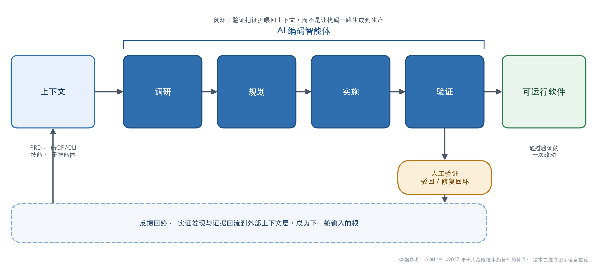

# i3 构建工作台 · 白皮书

> **让 AI 交付物上得去、回得来、有人签字。**
>
> 版本 1.2 · 2026 年 11 月 · 对应 i3 构建工作台 v3.2

---

## 写在前面

这份文档是写给一个人的。

你可能是一位交付负责人，手里刚拆完一份需求；也可能是一位工程师，花了几个星期把流程跑通了；也可能是业务方的接口人，下周就要用它。无论是谁，走到这个节点，真正让人睡不着的，往往不是「功能还差多少」，而是另外几个问题：

线上跑的到底是哪一版？出了问题退得回去吗？真出了事，谁能说清是谁批的、凭什么批？

我们做 i3，起因就是这个时刻。

它不打算帮你把页面画得更快，也不打算替你写更多代码。它想回答的是另一个问题：**当 AI 做出来的东西要走入生产，我们靠什么相信它。**

下面这些文字，讲我们怎么想、为什么这样设计，也讲我们目前还做不到什么。我们尽量说得像人和人说话——因为交付这件事，归根结底是人和人之间的事。

---

## 一、三个让人不安的时刻

### 第一个时刻：演示很顺，交付很难

周五下午的演示很顺利。流程一路跑通，业务方眼睛亮了，问：下周一能不能上？

团队回去准备，才发现真正缺的东西一样都不在演示里：需求边界、接口约定、验收标准、测试记录、构建产物。这些在演示时不重要，在交付时却一个都不能少。

大多数工具就在这里停下了——流程能跑，剩下的活留给人。而人手里的活，是最容易在交接时丢掉的那部分。

### 第二个时刻：上了线，退不回来

AI 系统从来不是一个程序，而是一组东西的组合：服务、提示词、编排、知识库、模型版本。它们各自升级、各自回退。

于是线上会出现最难查的一种状态：服务已经是新的，Agent 还是旧的；或者反过来。要退，只能把整段重来一遍；想退一半，往往留下一地半新半旧。出了问题，第一件说不清的事就是「现在到底在跑什么」。

### 第三个时刻：出了事，找不到人

没有审批，没有版本凭据，没有变更记录，回滚就只是「再发一次」。事后复盘，三个最基本的问题答不上来：谁改的、谁批的、依据是什么。

这三个时刻不是三件不相干的事，而是同一道缺口的三面：**缺一层面向交付的治理结构。**

不是缺工具。工具我们已经有了很多。缺的是让人能放心把东西交出去的那种结构。

---

## 二、我们的一个决定

我们只做了一个决定，剩下的一切都是它的推论：

> **把「交付单元」当作一等公民。**

### 交付单元是什么

交付单元是一次交付的最小单位：一组需求、一组制品、一次验收、一个版本号，绑在一起。

它只有两种构成：

| 构成 | 交付的是什么 | 怎么算合格 |
|---|---|---|
| **PBC** | 一个能跑起来的服务 | 引用闭合、制品全部接受、镜像与代码树一致、（视觉比对接入后）原型还原 |
| **Agent** | 一份能执行、能被评测的编排 | 上游闭合、工具白名单、digest 一致、评测达标 |

「服务加 Agent 一起上」不是第三个种类，而是**发布时的一次选择**。原因不复杂：一个单元只有一个 tag，而 tag 是整体凭据——它要么发，要么不发。所以混合单元在创建时就会被挡住，并告诉你应该从哪里拆。

### tag 是那条线

tag 不是版本号旁边的一个装饰。它是一份约定：**这一刻的交付物，就是我们认下的那一版。**

- 它只认 HEAD。历史交付不会被误当成「现在还能发」；
- 它锁住这版的 digest 与制品树，半年后有人问「线上跑的是哪一版」，能答得上来；
- 它是发布编排唯一认的东西。没打 tag 的单元不会进入任何批次，也不会被「顺手带上」。

打 tag 也不是一键的事。没有验收清单、清单没全过、清单出自旧提交、测试没全过、闸门有红项，
就是打不动，系统会点名是哪一种。清单不是手填的表格：AT 制品里那几条验收标准（AC-1..AC-5）
在交付收口时落成账本事实，每一条都绑着它出自哪个提交——改完代码重新交付，旧清单就不再算数。

我们刻意让它难打一点。因为一次随手的 tag，会在半年后变成一句说不清的「当时应该没问题吧」。

### 发布以批次为单位，不以单元为单位

单元各自上环境，必然出现「服务新、Agent 旧」。批次把「这一批包含谁」变成一个显式的决定：

- 勾选的最小单位，是**一次 tag**；
- 批次锁住勾选单元的 tag 与 digest，生成之后不可改；
- 回滚只能整批回——不允许只回一半；
- 没被勾选的单元保持线上现状，不会被捎带改动。

一句话：发布和回滚的单位，应该和你签字时的单位一致。

---

## 三、它每天的样子

### 工作空间、项目、交付单元

```
工作空间（一个文件夹，只做归集）
  └─ 项目（一份 BRD + 若干交付单元）
       └─ 交付单元（PBC 或 Agent）
```

工作空间不产生制品，只是把项目放在一起。项目是承接容器：一份 BRD 进来，被拆成几个单元。项目可以新建，也可以「加入已有」——加入不是复制，原项目仍留在原处，只是多了参与者。

### 四个阶段，和最后那一下人工

```
方案 → 原型 → 构建 → 验证 → 打 tag（人来做）→ 进发布池
```

前四个阶段是团队习惯的叫法。机器在背后做五件事：生成制品、收敛过期内容、原子提交、跑测试、编译构建。做完就停下，把最后一下留给人。

为什么留给人？因为「可以交付」这个判断，最终需要有一个具体的人来担。机器能证明测试过了、构建过了，但它没法替人签那个字。

还有一件容易误会的事：**单元自己不部署。** 部署属于发布批次。单元只做到「可以交付」为止。

### 发布编排

```
编排链：单元 A（就绪） → 单元 B（阻塞：还差 2 条验收） → 单元 C（就绪）
            ↓ 勾选
批次：环境（SIT / UAT / 预发 / 生产）× 方式（全量 / 灰度）
            ↓
锁定：tag + digest + 部署地址（PBC）；Agent 则标记「定义已激活」
```

在编排页上，就绪和阻塞是一眼能看见的：哪一条链走通了、卡在哪个单元、卡在什么原因。发布前可以先看预览：这一批会锁住哪些 tag、哪些 digest。生成之后就是生成之后，不再修改。

---

## 四、它是怎么搭起来的

### 一层一层看

```
┌──────────────────────────────────────────────────────────┐
│  前端（Vue 3 / Vite）  只读投影，不持有第二份真相          │
├──────────────────────────────────────────────────────────┤
│  BFF（Go）  /api、会话权限、SSE、静态托管                  │
├──────────────────────────────────────────────────────────┤
│  领域层  纯判断（门禁） + 事实账本（唯一权威） + 编排       │
├──────────────────────────────────────────────────────────┤
│  执行层  Dapr Workflow（派活/重试/超时） + 真执行链         │
│          生成制品 → go test → go build → 内容寻址 → 部署    │
├──────────────────────────────────────────────────────────┤
│  基础设施  Dapr sidecar / Redis（statestore + pubsub）     │
└──────────────────────────────────────────────────────────┘
```

前端只做一件事：把账本算出来的当前状态显示出来。它不自己记状态，也不做乐观更新——不会先让界面变绿，再去问后端行不行。

BFF 管接口和权限。领域层做判断，并把每个判断的依据写进账本。执行层负责真正去跑：生成、测试、构建、部署。底下的 Dapr 和 Redis 提供 workflow、状态与事件。

### 账本：我们只记发生过什么

系统里唯一权威的东西，是一条只追加的事实日志。

我们记的不是「现在是什么」，而是「发生过什么」。当前状态每次都是从头重放出来的。这个选择看起来很笨，但换来几件很值钱的事：

- **可回放**：任何页面、接口、报表，读的都是同一份投影；同样的账本，重放出同样的结果；
- **改不动**：每条事实带前序哈希，形成哈希链。有人改了中间一行，读的时候会直接报错，而不是将错就错地继续服务；
- **不覆盖**：同一本账的写入靠 etag CAS 排队，并发的输家写不进去，赢家不会被覆盖；
- **不表演**：前端不做乐观更新。越权或失败时，界面不会先变再回滚。

这意味着「发生过什么」不依赖谁的记忆，也不依赖某个进程是否还活着。

### 门禁：三种答案，而不是两种

| 答案 | 什么时候出现 | 能不能发 |
|---|---|---|
| 通过 | 有证据，且证据成立 | 可以 |
| 未通过 | 有证据，且证据不成立 | 不可以 |
| **判不了** | 这项能力还没接入，无法判定 | 不阻塞，但**不算通过** |

举一个具体的例子。视觉比对还没接入的时候，「原型还原」这条闸会明确写「判不了，别把它当成证据」，而不是默认零差异、画一个绿勾。

我们在这件事上有点固执：**把未知伪装成通过，是交付治理里最贵的错误。** 它不会当场出问题，它会在半年后的一次故障里出问题，而且那时候你已经找不到是哪个绿勾骗了你。

### 真的跑，不是演

- 测试：真的跑 `go test`，通过几条来自真实输出；
- 构建：真的编译，digest 是二进制字节的 SHA-256（内容寻址）；
- 部署：真的起进程，等到 `/healthz` 返回 200 才记成功；
- Agent 产物没有独立进程，就如实跳过部署、URL 留空，不编一个地址出来。

---

## 五、我们凭什么说它可信

可信不是「设计得很漂亮」，而是四件能被验证的事：

1. **可回放。** 任何状态都能从账本重放出来；账本被动过，会立刻暴露。
2. **可核对。** 测试过几条、digest 是什么、部署在哪，界面上就地能看到，不靠截图，也不靠口头汇报。
3. **可拒绝。** 没打 tag 的单元进不了批次；验收没过的单元打不了 tag；越权操作返回 403，而且账本里不留痕迹。
4. **可回归。** 核心链路由五套自动化验收覆盖，共 210 项断言（另有一套方案页布局 12 项，只读、不写账本）；断言数与依赖顺序以 `docs/EXECUTION.md` 的套件表为准。这些断言查的是账本事实，不是页面文案——页面改个措辞，不会让它们变绿。

第 4 条是我们最看重、也最日常的一条。它意味着后面接手的人不必相信我们的说法，跑一遍就知道。

---

## 六、它现在还不是什么

把边界写清楚，因为它同样是产品的一部分。

1. **视觉比对还没接。** 所以「原型还原」这条闸现在永远判不了。我们选择如实标注，而不是假装通过。
   同理，「制品生成」与「测试」两栏只说明机制是真跑（真落文件、真跑 `go test`）：
   生成内容是**按标题选术语 + 填骨架**，不是按这个单元的 spec 实现；测试验的是骨架自带的
   五条约定（健康 / 列表 / 幂等 / 统计一致 / 错误可读），不是 spec 里的业务口径。
   语言固定 Go、单一模板、无增量、无 spec 环节——边界与缺口见 `docs/EXECUTION.md` 第三节。
2. **模型推理目前是规则实现。** 评测跑的是内置评测集。接入真实模型之后，历史评测不能直接为新版本背书——那时候需要重跑，而不是引用旧结论。
3. **发布环境现在是标签。** SIT、UAT、预发、生产四套共用一套编排，部署到本地进程。真正的多环境资源和灰度放量，还在路上。
4. **组合单元不能自动拆。** 一个单元只有一个 tag。要独立上线，就得在拆分阶段拆成两个单元。系统会给出指引，但暂时不替你做这个动作。
5. **自托管时，数据全部留在你自己的机器上。** 账本、制品、部署进程都在本地，不往外发。

---

## 七、这件事，别人也看见了

前面说的三道坎，不是我们自己的焦虑。行业里已经有人给它起了名字。

Gartner 把「AI 编码智能体控制框架」列为 2027 年十大战略技术趋势之一（趋势 5）。它把眼下这一幕说得比我们更直白：编码智能体正在从「被动辅助工具」，变成「独立承担软件生产任务的自主系统」。于是问题的重心悄悄换了位置——**如果只放大代码生成，验证能力却没同步跟上，真正的难点就不再是写代码，而是如何证明改动安全、正确、可维护。** 它后面那句更不客气：代码生成一旦失去管控，技术债务会很快堆起来。

它给了个时间点：到 2026 年底，**20% 的公开代码提交会由自主编码智能体完成**。到那时候，这套闭环管控就是必需品，否则关键软件交付的质量无从保障。

它把这个框架画成一个贯穿软件开发生命周期的闭环：把编码平台接进来，灌入企业上下文，设置模型路由与验证关卡，再拉一条反馈回路，让每一次交付都符合安全与合规。说白了，管控不是给智能体踩刹车——**是让它跑得起来，也停得下来。**



它给的行动方案里，第三条我们读了很久：

> **实施自动交付背压机制——任何代码进入人工审查之前，先自动完成代码规范检查、测试、安全扫描和发布文档校验。**

读到这里，我们心里「对上了」。因为这几乎是 i3 里「打 tag 之前那五步」的另一种说法：生成制品、收敛过期内容、原子提交、跑测试、编译构建，全在人来签字之前跑完；有红项，就顶在那儿，人连签字的机会都没有。

它给的三条关键步骤，我们一条条对过去：

| 趋势 5 说的 | i3 里对应的东西 |
|---|---|
| ① 明确平台团队为责任主体 | 每个写动作都落在某个角色头上：PA 建单元、DA 发起交付、BA 判验收、SA 打 tag。越权返回 403，账本里不留痕迹——不是「有权限的人都能干」 |
| ② 架构标准与领域规则转成机器可读格式 | 门禁不是一份写在文档里的约定，是领域层里的纯函数。机器每次重算，改口径就得改代码、过测试，不是谁口头说一句就松了 |
| ③ 自动交付背压机制 | 打 tag 前的五步 + 闸门：测试没过、构建没过、验收没全过、闸门有红项，标签就打不动，还会点名差几条 |

再往上看它画的那个闭环，几个环节也都找得到落点：

| 闭环里的环节 | i3 里对应的东西 |
|---|---|
| 企业上下文 | BRD、需求池、交付单元——一次交付的边界被写成可追溯的输入 |
| 验证关卡 | 门禁——通过 / 未通过 / **判不了** 三种答案，判不了绝不画绿勾 |
| 反馈回路 | 事实账本——每个判断的依据都落成可回放的事实，喂回下一次 |
| 人工验证 | 打 tag 那一下——机器证明「过了」，但「可以交付」必须由一个具体的人来签 |
| 可运行软件 | 批次上环境——产物真的起进程、真的过 `/healthz`，URL 不留空，也不编 |

所以 i3 并不发明一套新概念。它只是把 Gartner 画的那个闭环，认真落到了「交付」这一端：不是让智能体写更多代码，而是让它写出来的东西**上得去、回得来、有人签字**。

也有三处我们和框架还差着，如实写在这里。

一是**模型路由**。框架把它当作控制面的一部分，i3 现在把模型当成一个可替换的规则实现，还没有真正接入（见「六、它现在还不是什么」）。

二是那份自动检查清单里的四项——**代码规范检查、测试、安全扫描、发布文档校验**。我们真做了的只有测试和构建；规范检查、安全扫描、发布文档校验都还没接上。这一步不冒充已经做了：空白就是空白，写清楚比补一句好听的话值钱。

三是**「谁是责任人」这一层还不够细**。账本记下了打 tag 的是哪一角色（SA），但会话里存的是角色、不是身份凭据——具体是哪一位，现在查不到。要接真正的 SSO，这一层才算补齐。

---

## 八、接下来

- **近期**：接入视觉比对，让「原型还原」从判不了变成真判；接入真实模型推理与评测；容器化多环境发布。
- **中期**：灰度真实放量；交付模板；审计导出；多租户。
- **长期**：跨组织交付——供应商交付、甲方验收，共用一套账本。

我们不打算把这些做成一张大而全的图。每一条都要能被验证，才写进路线图。

---

## 附录 A · 几个词

| 词 | 我们的意思 |
|---|---|
| 交付单元 | 一次交付的最小单位，PBC 或 Agent 之一 |
| tag | 单元在某个 HEAD 上的整体凭据，发布编排唯一认的东西 |
| 批次 | 一次发布动作锁定的若干 tag 与 digest，回滚以批次为单位 |
| 事实账本 | 只追加、哈希链、可回放的权威日志 |
| 门禁 | 发布前的判据集合，有三种答案：通过 / 未通过 / 判不了 |
| 判不了 | 能力还没接入，无法判定；不阻塞发布，但不算通过 |

## 附录 B · 验收摘要（v3.2，干净账本）

| 套件 | 覆盖 | 结果 |
|---|---|---|
| 全链路 | 四阶段、打 tag、批次发布、整批回滚、Backlog、Agent 工厂 | 57/57 |
| 执行侧 | 真测试、真构建、批次部署、回滚收进程、事件收发 | 28/28 |
| 写路径与权限 | 发起、越权拒绝、打 tag 权限 | 37/37 |
| 从零全流程 | 建单元到批次上线 | 20/20 |
| 工具体验回归 | 编排工作台、门禁、验收台 | 34/34 |

工程闸：`go vet`、`go test ./...`、`npm run build`，全绿。

---

*这份文档描述的是我们此刻的设计与边界。它会随着版本一起改，不会停在今天。*